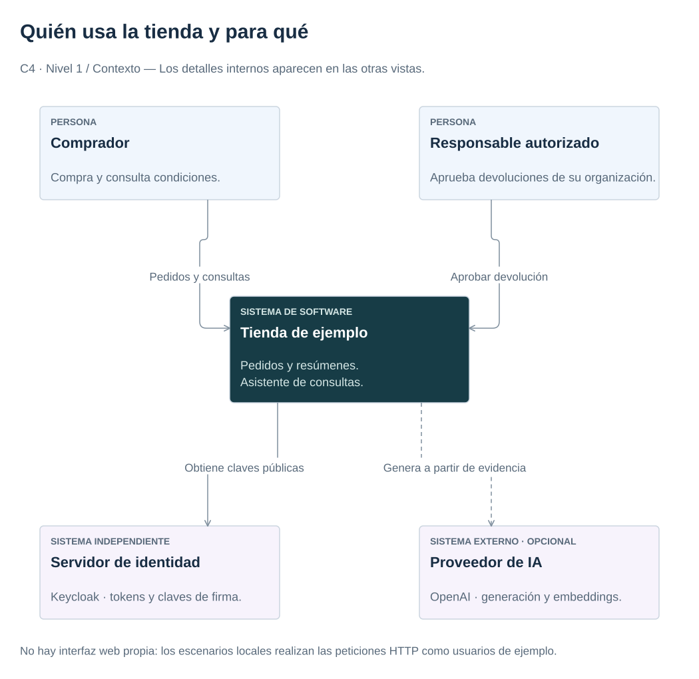

# 0. Preparar el entorno y ejecutar el primer pedido

[Índice del manual](index.md) · [Siguiente: organización del código →](handbook/architecture.md)

**Objetivo:** reconocer las aplicaciones del ejemplo y ejecutar una compra y su devolución completa antes de estudiar su implementación.

## 1. Entender el caso

Un comprador pide una unidad de `BOOK-1`, el código de producto o SKU del ejemplo. La API de comercio reserva stock y guarda el pedido. Después publica un evento: un mensaje que comunica que el pedido ya se ha creado. Otro proceso lo utiliza para actualizar el resumen de pedidos por producto y minuto.

El asistente consulta documentos para responder preguntas sobre devoluciones. También coordina una solicitud de devolución: un responsable debe aprobarla y Comercio vuelve a comprobar los permisos antes de reponer stock. El asistente no modifica directamente las tablas de negocio.

[](diagrams/c4-context.svg)

El diagrama muestra quién utiliza el sistema. Las aplicaciones y los datos se detallan en el [mapa de componentes](repository-design.md#component-map).

### Usuarios del ejemplo

Una organización, o *tenant*, es un ámbito de datos separado de los demás. Dos usuarios pueden utilizar la misma aplicación sin poder leer los pedidos de otra organización.

| Usuario | Organización | Permiso en la demostración |
|---|---|---|
| `alice` | `demo` | Comprar, consultar sus pedidos y solicitar una devolución. |
| `manager` | `demo` | Aprobar devoluciones de su organización. |
| `bob` | `other` | Utilizar su organización, sin acceder a los pedidos de Alice. |

Keycloak comprueba las credenciales y emite un token: un justificante firmado que el cliente envía a las APIs. Las APIs comprueban su identidad y permisos. El [capítulo 7](handbook/security.md) desarrolla este mecanismo; por ahora basta distinguir usuario, organización y permiso.

## 2. Preparar las herramientas

Ejecutar los comandos desde la raíz del repositorio. Para obtener una copia:

```bash
git clone https://github.com/victormartingil/software-architecture.git
cd software-architecture
```

| Herramienta | Cuándo se necesita |
|---|---|
| Docker Engine 25+ y Compose v2 | Ejecutar los servicios y las bases de datos. Reservar 10 GiB de memoria para el entorno completo con observabilidad. |
| Python 3.12, uv y Make | Ejecutar los scripts, las prácticas Python y los comandos comunes. |
| JDK 21 | Ejecutar las pruebas Java de los capítulos 1–4. La demostración usa el Java de los contenedores. Maven Wrapper descarga Maven. |
| kind y kubectl | Solo para la práctica opcional de Kubernetes del capítulo 9. |

Una imagen contiene la aplicación y lo necesario para ejecutarla; un contenedor es una ejecución de esa imagen. Docker Compose utiliza `compose.yaml` para arrancar y conectar los servicios del ejemplo. Los volúmenes conservan datos aunque se sustituyan los contenedores.

La primera construcción descarga imágenes y dependencias y necesita conexión a Internet. No se necesita una cuenta cloud ni una clave de IA.

## 3. Arrancar la tienda

```bash
make up
```

El comando construye las aplicaciones y espera a que los servicios estén disponibles. Comercio atiende en `http://localhost:8080`; la documentación interactiva del asistente está en [localhost:8081/docs](http://localhost:8081/docs).

Si el arranque falla, consultar `docker compose ps` y `docker compose logs --tail=80`. En una copia antigua con claves idempotentes V1, la migración puede bloquearse para no reinterpretar resultados previos: seguir el [procedimiento del ADR 002](decisions/002-consistency.md). No borrar solo la tabla de claves.

## 4. Ejecutar y leer la demostración

Cada compra lleva una clave de idempotencia: una cadena que permite reconocer el reintento de la misma operación. El capítulo 3 explica cómo se conserva su resultado. Antes de ejecutar la demostración, pensar qué debería pasar al enviar dos veces la misma compra y al intentar aprobar una devolución como comprador.

```bash
make demo
```

La demostración obtiene los tokens sin imprimirlos, realiza peticiones HTTP y comprueba estos pasos:

1. Crear el pedido y reservar una unidad. Repetirlo con la misma clave debe devolver el mismo resultado.
2. Rechazar la consulta de Bob al pedido de Alice y la aprobación de Alice sin permiso de responsable.
3. Consultar las políticas con citas. El modo `fake` indica que la respuesta está simulada.
4. Aprobar como responsable y ejecutar la devolución una sola vez, incluso al reintentar.
5. Comprobar que el stock vuelve a su valor inicial y que el evento del pedido aparece en SQL y en el resumen Kafka.

Al terminar debe aparecer `"result": "PASS"`, junto a los identificadores `orderId` y `workflowId` y las comprobaciones realizadas. Un UUID es un identificador escrito en cinco grupos de caracteres hexadecimales, como `11111111-1111-4111-8111-111111111111`. Los UUID cambian en cada ejecución. El escenario utiliza datos ficticios y debe ejecutarse sin otras operaciones que modifiquen el mismo stock.

Para volver a comprobar el resumen del pedido, sustituir el valor del ejemplo por el `orderId` obtenido:

```bash
make kafka-summary ORDER_ID=UUID_DEL_PEDIDO
```

`UUID_DEL_PEDIDO` es un marcador: sustituirlo por el identificador completo obtenido en la demostración.

## 5. Apagar y continuar

```bash
make down
```

Los datos se conservan entre arranques. `make reset CONFIRM=delete-local-data` los elimina de forma explícita; no hace falta ejecutarlo para seguir el manual. Las credenciales locales son ficticias (`local-demo-only`) y los puertos se publican solo en el propio equipo.

**Comprobación:** ¿por qué la respuesta del asistente no permite devolver un pedido sin aprobación? Porque una recomendación no concede permisos: Comercio conserva la decisión y comprueba al usuario cuando se solicita el efecto.

**Siguiente: [1. Organizar el código en módulos, puertos y adaptadores →](handbook/architecture.md)**
