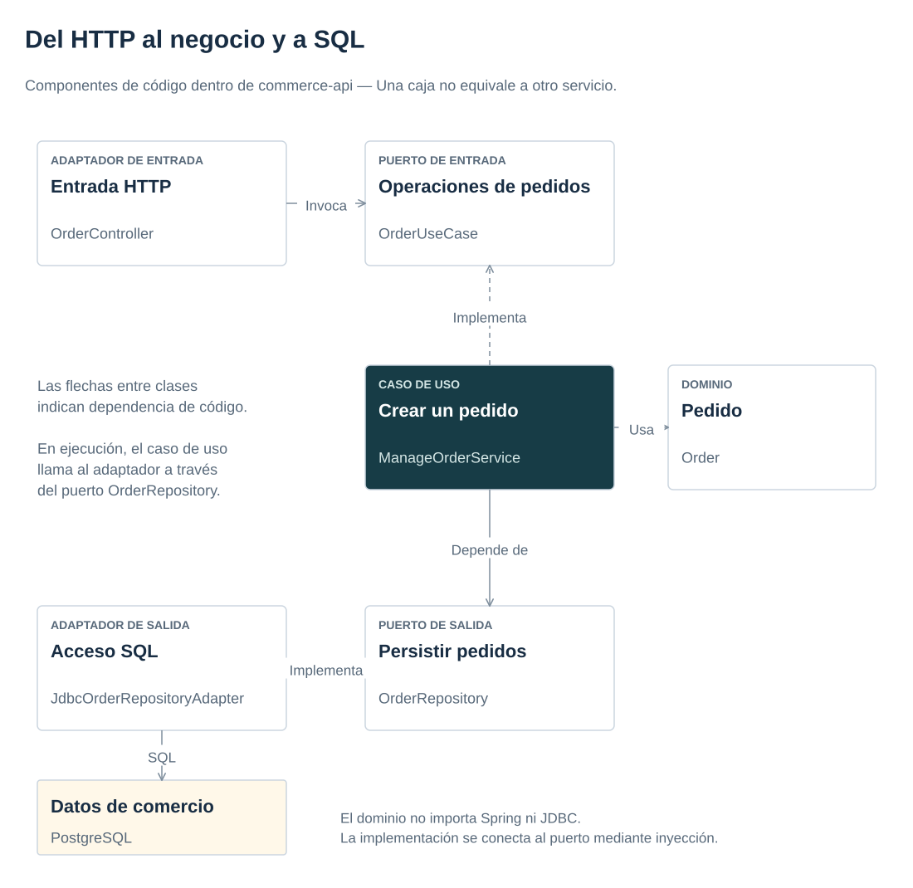

# 1. Organizar el código en módulos, puertos y adaptadores

[← Anterior](../getting-started.md) · [Índice del manual](../index.md) · [Siguiente →](api-contracts.md)

En el capítulo anterior se ha seguido un pedido desde fuera. Ahora se estudia su recorrido dentro de Comercio: la petición llega por HTTP, el caso de uso coordina el trabajo y un adaptador accede a PostgreSQL.

**Objetivo:** distinguir módulo, capa, puerto y adaptador, y localizar la regla que impide mezclar sus responsabilidades.

<a id="topic-problema-y-decision"></a>

## Separar las responsabilidades

Una regla como «no vender más unidades de las disponibles» debe sobrevivir a un cambio de transporte o base de datos. Interpretar una petición HTTP corresponde al controlador que la recibe. Separar estas responsabilidades reduce el número de conceptos que hay que entender para modificar cada una.

La aplicación de comercio agrupa `orders`, `inventory` y `returns`. Dentro de cada módulo, `domain` contiene conceptos; `application` coordina casos de uso y transacciones; `infrastructure` traduce HTTP, SQL y Kafka. Un puerto de entrada expresa una operación disponible. Un puerto de salida expresa una capacidad que esa operación necesita. Un adaptador implementa la traducción concreta. «Entrada» y «salida» describen la dirección de la llamada desde el caso de uso, no si el protocolo transmite bytes hacia dentro o fuera.

Para seguir una compra, abrir [ManageOrderService](../../apps/commerce-api/src/main/java/dev/reference/commerce/orders/application/service/ManageOrderService.java): recibe la solicitud, reserva inventario y guarda pedido y evento pendiente. El evento se estudiará en el capítulo 4. Después comparar [OrderRepository](../../apps/commerce-api/src/main/java/dev/reference/commerce/orders/application/port/output/OrderRepository.java) con su adaptador JDBC. El puerto expresa lo que necesita el caso de uso; el adaptador conoce cómo hacerlo con SQL.

[](../diagrams/ports-and-adapters.svg)

Un módulo reúne una capacidad del negocio; una capa separa responsabilidades dentro de ese módulo. `orders` e `inventory` comparten proceso Java y transacción, mientras `ai-service` es otro proceso con una frontera HTTP. Una interfaz Java es un contrato de código; no crea por sí sola un servicio de red.

Las dependencias de código apuntan al núcleo. En ejecución el caso de uso invoca un adaptador mediante su puerto: inversión de dependencias no significa invertir todas las llamadas. Se permite `@Transactional` en aplicación para que la frontera de commit sea fácil de localizar. Es un acoplamiento deliberado a Spring, descrito en el ADR; el dominio sigue independiente. Spring interpone un proxy: un objeto que rodea la llamada y abre/confirma/revierte la transacción. Una llamada directa al objeto fuera del proxy pierde esa intervención, como muestra el caso adicional descrito más abajo. Véase [cómo funciona la transacción declarativa](https://docs.spring.io/spring-framework/reference/data-access/transaction/declarative/tx-decl-explained.html).

Los tipos del dominio protegen reglas locales: `Quantity` valida 1..100 aun cuando se invoca el caso de uso sin HTTP; `OrderStatus` y `ReturnStatus` evitan estados escritos arbitrariamente. `ReturnProposal.requireExecutable` comprueba aprobación, versión y vencimiento usando una fecha recibida. No consulta base de datos ni reloj global. Las operaciones concurrentes siguen protegidas por transacciones, SQL condicional y restricciones de la base de datos: validar un objeto no sustituye el control concurrente.

`BusinessException.Kind` expresa INVALID_INPUT, NOT_FOUND, CONFLICT o FORBIDDEN. El dominio no conoce 400, 404 o 409; [ProblemAdvice](../../apps/commerce-api/src/main/java/dev/reference/commerce/shared/infrastructure/rest/ProblemAdvice.java) traduce a Problem Details. Los controladores pertenecen a su módulo; persistencia, mensajería y seguridad se distinguen por subpaquetes.

<a id="topic-por-que-tres-servicios"></a>

## Por qué tres servicios

Commerce tiene una única transacción de negocio. Dividir pedidos e inventario en servicios introduciría consistencia eventual y compensaciones sin mejorar este ejemplo. Analytics escala y reconstruye una proyección independiente. AI tiene dependencias, costes y ciclo de ejecución distintos; solo accede a comercio por HTTP. Estas diferencias justifican procesos separados. El tamaño de una clase o una entidad no los justifica por sí solo.

Un monolito modular sería una alternativa razonable para una tienda real pequeña. La referencia separa procesos para poder observar fallos de red, replay y permisos entre sistemas. No propone copiar esta topología en cualquier producto.

<a id="topic-patrones-con-una-responsabilidad-concreta"></a>

## Patrones con una responsabilidad concreta

| Patrón | Dónde | Beneficio y coste |
|---|---|---|
| Adapter | HTTP/JDBC/proveedor IA | Traducción sustituible; exige mantener el contrato |
| Repository | Puertos de datos de comercio | Oculta SQL al caso de uso; evitar repositorio genérico universal |
| Frontera de integración | Gateway de comercio por intención | Oculta HTTP/JSON y traduce resultados; exige validar el contrato externo |
| Strategy | Búsqueda léxica/vectorial | Mismo objetivo, implementaciones comparables |
| Composición | Ensamblado Spring/FastAPI | Colabora por contratos; evita herencia por reutilización incidental |
| [Outbox/Inbox](events.md) | Publicación/auditoría | Resuelve ventanas de fallo; requiere retención y operación |
| [Circuit Breaker](security.md) | Proveedor IA | Acota fallos repetidos; no corrige una dependencia caída |

Un Command pide un cambio y una Query solicita información. CQRS (separación de responsabilidades de comandos y consultas) separa los modelos de escritura y lectura; no obliga a desplegar dos servicios. Event-driven comunica hechos mediante eventos. Event sourcing conserva el historial de eventos como fuente de verdad para reconstruir el estado. Commerce mantiene el estado actual en SQL y publica un outbox; Analytics construye un resumen derivado. Esas decisiones no convierten el dominio en event sourcing. Factory, Observer o Decorator se explican cuando resuelven un caso concreto; no se añaden capas para demostrar nombres. Para patrones adicionales, consultar el [catálogo de Refactoring.Guru](https://refactoring.guru/design-patterns) y contrastar ejemplos antes de reutilizar código.

## Práctica guiada: comprobar las dependencias permitidas

### 1. Seguir el código

Leer el caso de uso y puerto enlazados arriba y [ArchitectureTest](../../apps/commerce-api/src/test/java/dev/reference/commerce/ArchitectureTest.java). Desde la raíz, con Java 21 y Docker disponible para consultar su contexto:

### 2. Predecir el resultado

Una clase de dominio importa Spring. ¿Qué debería detectar la regla de arquitectura? Anotar una respuesta antes de ejecutar los comandos.

### 3. Ejecutar y comparar

```bash
(cd apps/commerce-api && \
  DOCKER_HOST="$(docker context inspect --format '{{.Endpoints.docker.Host}}')" \
  TESTCONTAINERS_DOCKER_SOCKET_OVERRIDE=/var/run/docker.sock \
  ./mvnw -B -ntp -Dapi.version=1.44 -Dtest=ArchitectureTest test)
(cd apps/ai-service && uv run pytest tests/test_architecture.py -q && uv run lint-imports)
```

**Qué observar:** las pruebas deben pasar. Algunas importan clases deliberadamente incorrectas y comprueban que la regla detecta la dependencia concreta: Spring o Jackson en dominio, un adaptador en aplicación o el repositorio privado de otro módulo. Otras permiten colaborar por un puerto de entrada. Que el conjunto pase significa que reconoce tanto usos válidos como infracciones, no que esas infracciones estén permitidas.

[ArchitectureRules](../../apps/commerce-api/src/test/java/dev/reference/commerce/ArchitectureRules.java) contiene la misma política para código productivo y ejemplos de prueba. Estos últimos se excluyen del análisis de producción. El [capítulo 3](transactions.md) estudia las garantías de transacción y concurrencia. En CommerceIntegrationTest, el caso `directInvocationBypassesTransactionAndLeavesPartialEffects` compara además el servicio a través del proxy con una llamada directa al objeto: la segunda evita la intervención transaccional de Spring.

Un módulo puede respetar sus capas y aun así formar un ciclo con otro: `orders → returns → orders` impide evolucionarlos de forma independiente. La regla de [slices de ArchUnit](https://www.archunit.org/userguide/html/000_Index.html#_slices) agrupa el módulo funcional completo y rechaza ciclos; `shared` y la composición no son módulos de negocio. La misma práctica comprueba que producción selecciona los tres módulos y pasa, que dos ciclos deliberados fallan por sus dependencias reales y que una colaboración acíclica por input con tipos compartidos está permitida. No impone una lista fija de todas las colaboraciones futuras.

**Alternativa:** llamar directamente a JDBC ahorra un puerto, pero acopla el caso de uso a persistencia. Justificar cada abstracción por una sustitución o responsabilidad concreta; la revisión sigue siendo necesaria para detectar interfaces vacías o conceptos filtrados.

## Documentación del capítulo

[arquitectura hexagonal original](https://alistair.cockburn.us/hexagonal-architecture), [ArchUnit](https://www.archunit.org/userguide/html/000_Index.html), [import-linter](https://import-linter.readthedocs.io/en/stable/contract_types/layers/).

<a id="topic-lectura-y-repositorio-de-referencia"></a>

## Para profundizar

Lectura: [*Fundamentals of Software Architecture*, 2.ª edición](https://www.oreilly.com/library/view/fundamentals-of-software/9781098175504/), para estilos, límites, decisiones y evolución de arquitectura. Como ejemplo implementado, [Spring Modulith: ApplicationModules](https://github.com/spring-projects/spring-modulith/blob/main/spring-modulith-core/src/main/java/org/springframework/modulith/core/ApplicationModules.java) modela y verifica módulos en aplicaciones Spring. Es una referencia de la biblioteca, no una dependencia de este proyecto.

## Comprobar lo aprendido

¿Qué problema introduce que dos módulos se llamen mutuamente, aunque utilicen puertos de entrada?

<details>
<summary>Ver la explicación</summary>
<p>Introducen un ciclo entre módulos. Respetar las capas no elimina esa dependencia circular; hace falta revisar la dirección de la colaboración.</p>
</details>

Ya se puede seguir una operación dentro del código. El siguiente capítulo estudia el contrato HTTP que utiliza su cliente.

---

[← 0. Preparación](../getting-started.md) · [Índice](../index.md) · [2. Definir contratos HTTP y paginar resultados →](api-contracts.md)
