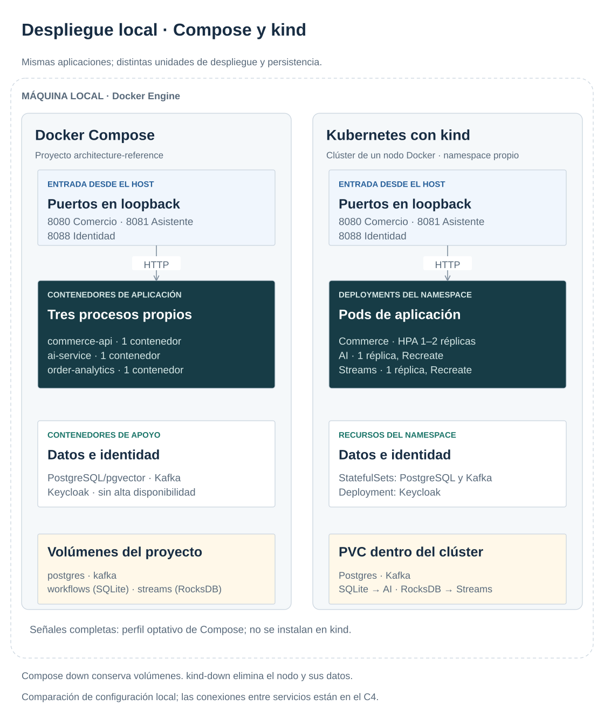
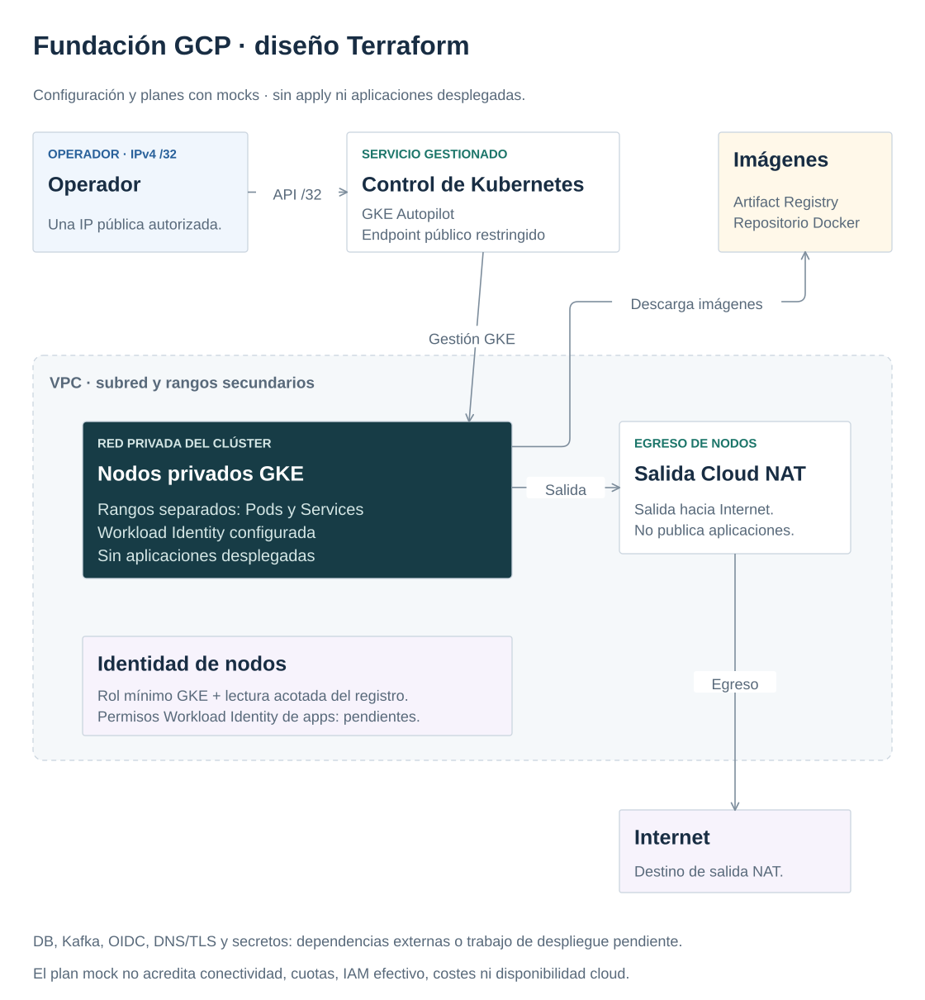

# Contenedores, Kubernetes y Terraform

## Tres niveles distintos de prueba

Compose verifica colaboración local de servicios. kind verifica manifiestos y comportamiento de Kubernetes en un clúster local dedicado. Terraform con mocks verifica forma y decisiones del plan. Ninguno de estos niveles demuestra por sí solo un despliegue cloud correcto o disponible.

Las aplicaciones usan imágenes separadas y usuarios no-root, probes y memoria acotada. Las dependencias locales son deliberadamente simples: un PostgreSQL/pgvector, un broker KRaft y Keycloak de desarrollo. Las bases tienen usuarios distintos por dueño. Los puertos host se enlazan a loopback; no exponer esta configuración a Internet.

[](../diagrams/deployment-local.svg)

[Maestro draw.io](../diagrams/architecture.drawio). Editar el `.drawio` con draw.io y volver a exportar el SVG. Las cajas agrupan recursos de despliegue; las conexiones entre aplicaciones están en el [C4](../repository-design.md).

## Laboratorio Kubernetes

```bash
make down
make kind-up
make kind-smoke
make kind-scale-check
make kind-down
```

El script crea únicamente el clúster `architecture-reference` y conserva su kubeconfig en `reports/`, sin cambiar el contexto global. Namespace, volúmenes e imágenes pertenecen al laboratorio. La carga usa consultas autenticadas de inventario: no crea miles de pedidos para forzar CPU. El [verificador](../../scripts/kind-scale-check.py) exige transición real de una réplica en reposo a dos bajo GET autenticados: cinco minutos, máximo 300/s y 16 workers. Comprueba CPU, réplicas deseadas/listas y endpoints. No fuerza el escalado; falla si faltan recursos o métricas.

Requests permiten al scheduler reservar capacidad; limits acotan consumo. Un probe de vida detecta proceso bloqueado; uno de readiness indica si debe recibir tráfico. No hacer reiniciar todos los pods porque una dependencia temporal cayó: puede amplificar el incidente. PDB ayuda en interrupciones voluntarias, sin proteger frente a fallos de nodo ni sustituir varias réplicas.

Commerce puede escalar de una a dos réplicas porque la idempotencia, stock y transiciones viven en PostgreSQL. El HPA usa métricas de CPU con requests explícitas. Añadir pods no añade CPU al único nodo kind: sobrecargarlo puede producir errores aunque el HPA funcione. El generador limita ritmo, reutiliza conexiones y clasifica fallos para observar el mecanismo sin confundirlo con un benchmark de capacidad. En kind se permite TLS inseguro de kubelet para metrics-server, excepción local documentada. No trasladar esa opción a producción.

Después envía el mismo pedido concurrentemente a ambos pods mediante port-forwards distintos. Respuestas iguales y stock reducido una vez prueban idempotencia compartida. Una devolución autorizada restaura stock, conservando auditoría sintética. Cierra carga y port-forwards incluso ante fallo; conserva el clúster. El informe queda en `reports/kind-scale-check.json`. Sin carga, el HPA puede volver a una réplica tras sesenta segundos de estabilización; la prueba no modifica esa política.

AI mantiene una réplica con estrategia Recreate. SQLite y un lock de proceso no coordinan varios pods; un volumen RWO tampoco es un protocolo de exclusión de negocio. Para escalar se requiere estado compartido y control concurrente distribuido. El sistema debe reconocer esta restricción antes de configurar un autoscaler que la viole.

## Fundación cloud

```bash
make terraform-check
```

La [configuración GCP](../../infra/cloud/main.tf) define red, subredes, salida NAT, Artifact Registry, identidad de nodos y GKE Autopilot. Fija CLI y provider. El plano de control limita acceso a un `/32` de operador; nodos privados y Workload Identity forman parte de la base. DB, Kafka gestionado, OIDC, TLS, secretos y sus permisos son entradas o trabajo de despliegue explícito. No se crea un cluster con `apply`.

[](../diagrams/cloud-foundation.svg)

[Maestro draw.io](../diagrams/architecture.drawio). Esta vista describe configuración comprobada con mocks, no infraestructura desplegada.

Cuatro pruebas mock comprueban la base y rechazan CIDR abierto, IPv6 e IPv4 inválida. La identidad de nodos recibe el rol mínimo GKE a nivel de proyecto y lectura de imágenes acotada al repositorio; las aserciones verifican intención y ámbito, no un número de roles. No verifican cuotas, IAM real, conectividad, facturación ni disponibilidad de recursos. Antes de producción harían falta backend de estado remoto con bloqueo, pipelines de plan/aprobación, política de secretos, backup probado y presupuesto. NAT y GKE generan costes incluso sin usuarios.

## Delivery, cambios y reversión

CI ejecuta pruebas, reglas de dependencia, contratos, evaluación offline y documentación. Un scan de dependencias añade señales de vulnerabilidad; no acredita ausencia de vulnerabilidades ni una auditoría de seguridad completa. Actualizar lockfiles en cambios revisables, probar compatibilidad y retirar versiones obsoletas con criterio.

Si se necesita un despliegue con versiones mezcladas, las migraciones deben ser compatibles: añadir antes de eliminar, medir uso y retirar después. Un rollback de imagen no revierte automáticamente una migración destructiva ni un evento ya publicado. Las versiones del contrato y las claves idempotentes necesitan convivir durante el plazo de replay. V2 de idempotencia exige parada de escritores y rechaza datos V1 ambiguos: es una excepción explícita, sin prometer actualización gradual; véase [ADR002](../decisions/002-consistency.md).

## Reutilizar la referencia en un sistema real

Trasladar decisiones y pruebas, no copiar el Compose como despliegue productivo. Fijar requisitos del producto antes de añadir componentes:

| Decisión local | Adaptación y prueba exigida según el producto |
|---|---|
| PostgreSQL/Kafka/OIDC únicos | Servicio gestionado o topología redundante; probar caída y restauración con RPO/RTO acordados. |
| Credenciales sintéticas y HTTP local | Identidad real, TLS y gestor de secretos; verificar permisos mínimos y rotación. |
| SQLite y cupos por proceso | Mantener una réplica si basta; para escalar, estado durable compartido y concurrencia distribuida probada. |
| HPA CPU y dashboard del laboratorio | Medir carga representativa, saturación, latencia y SLO; dimensionar datos y proveedor, no solo pods. |
| Terraform mock y migración V2 con parada | Revisar plan/IAM reales, estado remoto y procedimiento de reversión; probar migraciones con datos representativos. |

La alternativa inicial a Kubernetes es un servicio gestionado de contenedores con datos gestionados. Reduce operación cuando no se necesita el control del cluster. Kubernetes se muestra aquí por sus mecanismos y restricciones, sin declarar que toda aplicación los necesite.

## Micropráctica: permisos por intención

**Pregunta:** ¿un test que cuenta roles detectaría un permiso demasiado amplio? Leer [main.tf](../../infra/cloud/main.tf), [variables.tf](../../infra/cloud/variables.tf) y [plan.tftest.hcl](../../infra/cloud/tests/plan.tftest.hcl). Desde la raíz, con Docker:

```bash
make terraform-check
```

**Resultado:** formato y validación correctos; cuatro planes mock aprobados, sin credenciales cloud ni `apply`. El fallo controlado introduce direcciones de operador inválidas y exige que las rechace. El plan válido conserva Autopilot, nodos privados y permisos concretos de nodo e imágenes.

**Alternativa:** ejecutar solo `validate` prueba sintaxis y tipos, sin comprobar esa política. Mocks tampoco acreditan IAM efectivo: un despliegue autorizado requeriría pruebas reales. En local, `make kind-smoke` enlaza el pedido de su ejecución con SQL y Kafka del clúster; no reutiliza conexiones Compose. No es necesario levantar kind para esta micropráctica.

Fuentes: [kind](https://kind.sigs.k8s.io/docs/user/quick-start/), [HPA](https://kubernetes.io/docs/tasks/run-application/horizontal-pod-autoscale-walkthrough/), [Terraform mocks](https://developer.hashicorp.com/terraform/language/tests/mocking), [GKE Autopilot](https://cloud.google.com/kubernetes-engine/docs/concepts/autopilot-overview).
