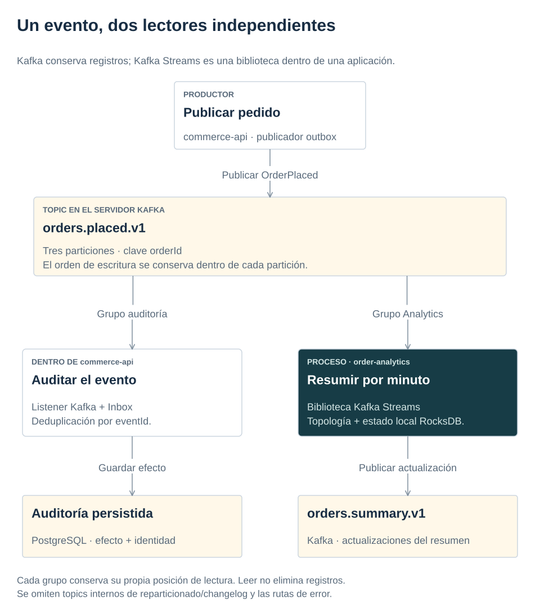
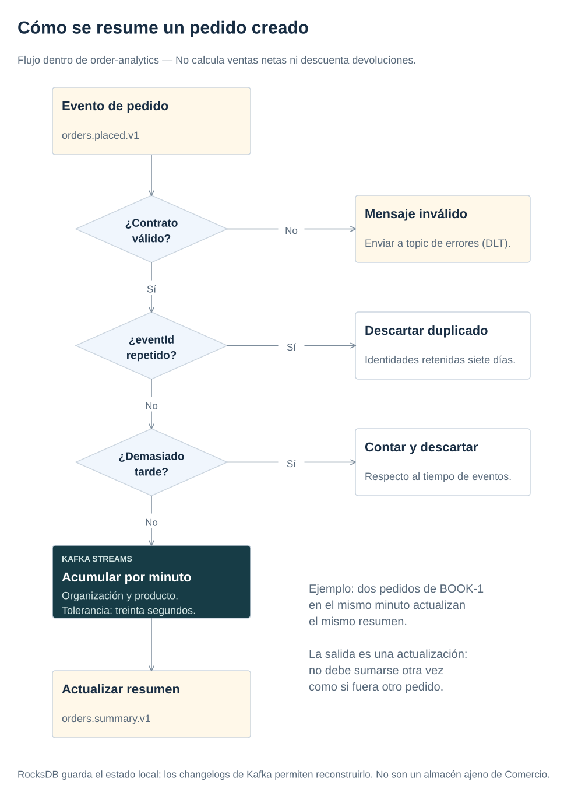

# 4. Publicar eventos y procesarlos con Kafka Streams

[← Anterior](transactions.md) · [Índice de la referencia](../index.md) · [Siguiente →](retrieval.md)

El capítulo 3 guardó pedido, stock y evento pendiente en una transacción. Falta entregar ese evento a otros procesos. Aquí se sigue desde el outbox hasta la auditoría y el resumen por minuto.

**Objetivo:** distinguir Kafka de Kafka Streams y razonar sobre duplicados, posiciones de lectura y ventanas temporales.

<a id="topic-kafka-eventos-y-streams"></a>

## Kafka: eventos y Streams

Un evento es un registro que cuenta algo que ya ocurrió, como `OrderPlaced`; no es una consulta del estado actual del pedido. Kafka conserva esos registros en canales llamados topics. Cada topic se divide en particiones, que son secuencias ordenadas de registros. La clave `orderId` reúne los registros del pedido en una partición mientras se conserva la estrategia de particionado. Kafka conserva el orden de escritura de esa partición; no establece un orden global ni reconstruye por sí solo el orden causal del negocio.

El servidor de Kafka también se denomina broker. Kafka recibe y entrega registros. Kafka Streams es una biblioteca Java que se ejecuta dentro de una aplicación consumidora: puede filtrar, agrupar y resumir esos registros y publicar resultados en otro topic. Un consumidor Kafka común también puede escuchar eventos sin usar Streams. En esta referencia, Commerce publica `OrderPlaced`; el consumidor de auditoría aplica Inbox, mientras `order-analytics` usa Streams para resumir pedidos por tenant, SKU y minuto. El evento describe un hecho; el resumen es una proyección derivada y puede recibir varias actualizaciones.

[](../diagrams/kafka-consumers.svg)

Kafka Streams vive dentro de `order-analytics`; no es otro servidor que haya que instalar. El esquema omite los topics internos de reparticionado/changelog, detallados en la topología y el flujo de resumen.

Un grupo de consumidores (consumer group) identifica un lector lógico: auditoría y Analytics tienen grupos distintos y ambos reciben el historial disponible. Dentro de un grupo, las instancias se reparten las particiones. El offset es la posición de lectura de una partición, no el identificador del evento. Leer o confirmar un offset no borra el registro: su conservación depende de la retención.

<a id="topic-publicar-despues-de-confirmar"></a>

<a id="ref-topic-r14"></a>

## Publicar después de confirmar

Guardar un pedido y enviar un mensaje a Kafka son dos escrituras en sistemas distintos. Si la primera funciona y la segunda falla, el consumidor nunca recibe el hecho. Enviar primero invierte el problema: puede publicarse un pedido que luego no existe. `@Async` cambia el hilo, sin crear atomicidad.

El outbox es una tabla de eventos pendientes: guarda el evento en la misma transacción que el pedido. Un publicador reclama lotes pendientes con `FOR UPDATE SKIP LOCKED` (bloquea las filas elegidas y omite las que otro publicador ya ha bloqueado), envía y espera confirmación del broker antes de marcarlos. Si cae tras enviar y antes de marcar, publicará de nuevo. La garantía es entrega al menos una vez dentro de las condiciones de retención y recuperación; el consumidor debe tolerar duplicados.

`OutboxPublisher` reclama hasta veinte filas pendientes con bloqueo. Su scheduler espera un segundo tras terminar el lote antes de volver a consultar; una publicación lenta alarga el intervalo. Consultar periódicamente si hay trabajo pendiente se llama polling. Aquí se usa para publicar el outbox; el cliente no lo utiliza para consultar el estado del pedido. La respuesta HTTP no espera a Kafka. La transacción del publicador sí permanece abierta mientras espera los ACK: retiene conexión y bloqueos del lote. `SKIP LOCKED` permite reclamar otras filas, pero una caída lenta del broker aumenta esperas y ocupación SQL. Ordenar el lote por UUID no demuestra orden causal de negocio entre publicadores; un requisito de secuencia por agregado necesitaría un protocolo explícito.

El inbox registra los eventos ya procesados. El consumidor de auditoría utiliza esa tabla con `UNIQUE(eventId)`. Registrar identidad y efecto se hace en una transacción; el offset se confirma después. Un reinicio puede repetir un mensaje pero la restricción evita un segundo efecto. La identidad de evento debe mantenerse en los reintentos y en el reproceso. Generar un UUID nuevo convierte la repetición en otro hecho. El inbox SQL no tiene purga automática en esta referencia: crece mientras se conserva la base. Su horizonte no es el de siete días del store de Analytics; una limpieza futura exige acordar primero el replay soportado.

El contrato vive en [orders.placed.v1](../../contracts/events/orders.placed.v1.schema.json). Tenant, correlación, versión y tiempo pertenecen al sobre; el contenido contiene solo datos sintéticos necesarios. La clave Kafka es orderId para conservar orden por pedido dentro de su partición. No existe un orden total entre las tres particiones.

Los consumidores validan el contrato antes de producir efectos. Los identificadores UUID se exigen completos y se normalizan para que mayúsculas y minúsculas conserven la misma identidad; el [corpus de casos de prueba](../../contracts/events/fixtures/uuid-cases.json) recoge formas válidas e inválidas.

<a id="ref-topic-r15"></a>

## Mensajes inválidos

Un error transitorio admite reintentos limitados. Un mensaje estructuralmente inválido no se arregla esperando: termina en una DLT (dead-letter topic): un topic de mensajes fallidos para investigación y reproceso controlado, separado para auditoría y analytics. Si publicar la DLT falla, no se debe confirmar el original como procesado. El [procedimiento de recuperación](operations.md) explica cómo investigar la causa y volver a enviar un evento reparado. Ese reproceso, o replay, debe ser explícito y conservar su identidad.

La evolución debe mantener forma y semántica compatibles. Aquí los esquemas y el codec rechazan campos desconocidos: incluso añadir un campo opcional requiere actualizar primero consumidores o publicar una versión distinta. No se presupone tolerancia automática. Cambiar el significado del importe o su unidad exige una decisión de versión. Un esquema valida forma y algunas restricciones; no demuestra que un hecho corresponda a una transacción autorizada. La prueba compara eventos realmente producidos, además de ejemplos preparados.

<a id="topic-ventanas-y-deduplicacion"></a>

<a id="ref-topic-r16"></a>

## Ventanas y deduplicación

[OrderSummaryTopology](../../apps/order-analytics/src/main/java/dev/reference/analytics/OrderSummaryTopology.java) resume pedidos por organización, producto y ventana de un minuto usando `occurredAt`, el tiempo del hecho. La tolerancia, o grace, es de treinta segundos. Se calcula respecto al avance del tiempo observado por la tarea de procesamiento (stream time). No significa esperar treinta segundos de reloj tras cada mensaje.

[](../diagrams/order-summary-flow.svg)

La clave cambia para colocar cada decisión junto a su estado:

| Etapa | Clave | Por qué cambia y qué estado consulta |
|---|---|---|
| Entrada | `orderId` | Reúne hechos de un pedido en su partición de entrada. |
| Primera repartición, `event-identity` | `eventId` normalizado | Lleva duplicados de distintas particiones al mismo store de deduplicación; cambiar solo la clave con `selectKey` no redistribuye físicamente los registros. |
| Segunda repartición, `tenant-sku` | JSON `[tenant, sku]` | Reúne pedidos distintos del mismo producto/organización antes de comprobar tardanza y agregar. |
| Agregación y salida | `[tenant, sku]` + inicio de ventana | Mantiene un agregado por minuto; la clave serializada de salida añade `@windowStartMillis`. No necesita una tercera repartición. |

Ambas reparticiones intercambian registros mediante topics internos: cuestan red, almacenamiento y operaciones de Kafka. Deduplicar después de agrupar por producto no resolvería correctamente una identidad repetida enviada con otra clave de entrada. El contrato exige además que el mismo `eventId` conserve el mismo hecho y payload; la deduplicación reconoce identidad, no compara ni reconcilia contenidos distintos.

El store conserva como marca `max(occurredAt, stream time)` al aceptar una identidad. La consulta ignora una marca vencida y un barrido cada hora de **stream time** elimina entradas antiguas. Siete días sin nuevos eventos no hacen avanzar ese reloj ni disparan el barrido; el espacio físico puede conservar entradas hasta la siguiente limpieza. El [README técnico](../../apps/order-analytics/README.md#flujo-y-garantías) detalla esa política.

Un `KStream` interpreta cada registro como un hecho individual; una `KTable` interpreta la última actualización de cada clave como su valor actual. La agregación de esta topología produce una tabla por tenant/SKU/ventana y la vuelve a publicar como registros. El topic de salida publica actualizaciones de una tabla: la misma clave de ventana puede aparecer varias veces con un agregado más reciente. Por ejemplo, dos pedidos distintos de un mismo producto y organización en una ventana pueden publicar primero `orderCount=1` y después `orderCount=2`. El total actualizado es 2, no la suma 1 + 2. No sumar esas actualizaciones como si fueran hechos distintos. El resultado cuenta creaciones, aunque después exista una devolución; llamarlo ventas netas sería incorrecto. La deduplicación dura siete días, acorde al contrato de retención. La retención del topic, la identidad almacenada para deduplicar y el plazo de claves idempotentes son decisiones distintas: conservar un mensaje no implica conservar indefinidamente la memoria de sus efectos. Un replay más antiguo requiere otra política y pruebas; no ampliar una retención aislada suponiendo que amplía todas las garantías.

Las ventanas son consecutivas y no se solapan: `[10:00, 10:01)` incluye las 10:00, pero excluye las 10:01, que pertenecen a la siguiente.

Dos casos ilustrativos independientes para esa ventana, con marcas de tiempo válidas:

| Hora del hecho recibido | Tiempo observado por la tarea (stream time) | Resultado |
|---|---|---|
| 10:00:50 | 10:01:10 | Todavía dentro de los 30 s de tolerancia |
| 10:00:50 | 10:01:40 | Ventana cerrada: aumenta la métrica de tardíos y se descarta sin modificar el agregado |

El stream time avanza con las marcas de tiempo de los eventos observados por la tarea. Esperar treinta segundos sin recibir registros no equivale a ese avance.

El almacén local (state store) permite consultar el agregado; un registro de cambios en Kafka (changelog) permite reconstruirlo. No es una copia de seguridad universal: depende de retención, identidad de aplicación y disponibilidad de Kafka. El laboratorio verifica reinicio y restauración; la topología determinista verifica ventanas y mensajes tardíos sin esperas reales.

El lag es la distancia entre lo publicado y la posición del consumidor. Observarlo junto a la capacidad antes de añadir tareas; consumir más deprisa puede trasladar el cuello de botella a SQL o al procesamiento.

<details markdown="1">
<summary>Límites de consumo, arranque y parada del laboratorio</summary>

El consumidor limita cada poll a 100 registros y pausa por partición al superar un umbral de 100 en su cola; un lote puede excederlo. Son umbrales por lote o partición, no límites globales de memoria o caudal. `StreamsLifecycle` espera el estado RUNNING hasta 60 s y solicita cierre hasta 20 s, con readiness HTTP/archivo retirado durante redistribución de particiones (rebalance) y parada. Compose y Kubernetes conceden 30 s de terminación. Si se agota el plazo, el cierre se comunica como fallido.

</details>

Analytics configura `exactly_once_v2`: offsets, changelog y salida se confirman dentro de la transacción Kafka. Sus consumidores deben leer con `isolation.level=read_committed`. Esta atomicidad no incluye PostgreSQL ni HTTP; eventId sigue siendo necesario para reconocer publicaciones repetidas del mismo hecho de negocio.

<a id="topic-relojes-incorrectos-y-cuarentena"></a>

<a id="ref-topic-r17"></a>

## Relojes incorrectos y cuarentena

El tiempo de evento decide cuándo se cierra una ventana. Un `occurredAt` de 2099 puede adelantar el tiempo observado por la tarea y convertir pedidos actuales en descartes tardíos. [OrderSummaryTopology](../../apps/order-analytics/src/main/java/dev/reference/analytics/OrderSummaryTopology.java) aplica una tolerancia máxima de treinta segundos respecto al reloj del proceso antes de asignar la marca de tiempo. Un mensaje inválido conserva el tiempo previo de la partición (cero al inicio) y va a DLT: tampoco se confía en su timestamp Kafka. Solo la rama DLT asigna hora de cuarentena, para que su retención no nazca vencida. El límite exacto se admite; [la regresión](../../apps/order-analytics/src/test/java/dev/reference/analytics/OrderSummaryTopologyTest.java) comprueba que el siguiente pedido actual sigue agregándose. Sincronizar relojes y revisar DLT; el replay del pasado sigue sujeto a grace/retención, no se convierte en una reconstrucción histórica automática.

<a id="practica-guiada-recuperar-un-mensaje-y-reconstruir-el-resumen"></a>
<a id="práctica-guiada-recuperar-un-mensaje-y-reconstruir-el-resumen"></a>

## Comprobación reproducible: recuperar un mensaje y reconstruir el resumen

### 1. Seguir el código

Leer [KafkaConfiguration](../../apps/commerce-api/src/main/java/dev/reference/commerce/shared/infrastructure/messaging/KafkaConfiguration.java), [CommerceIntegrationTest](../../apps/commerce-api/src/test/java/dev/reference/commerce/CommerceIntegrationTest.java) y [KafkaRecoveryTest](../../apps/order-analytics/src/test/java/dev/reference/analytics/KafkaRecoveryTest.java). Desde la raíz, con Java 21 y Docker:

### 2. Predecir el resultado

Si falla el envío de un mensaje inválido a la DLT, ¿debería avanzar el offset como si se hubiese procesado? Anotar una respuesta antes de ejecutar los comandos.

### 3. Ejecutar y comparar

```bash
(cd apps/commerce-api && \
  DOCKER_HOST="$(docker context inspect --format '{{.Endpoints.docker.Host}}')" \
  TESTCONTAINERS_DOCKER_SOCKET_OVERRIDE=/var/run/docker.sock \
  ./mvnw -B -ntp -Dapi.version=1.44 '-Dtest=CommerceIntegrationTest#failedDltPublicationDoesNotCommitOriginalOffsetAndRecovers' test)
(cd apps/order-analytics && \
  DOCKER_HOST="$(docker context inspect --format '{{.Endpoints.docker.Host}}')" \
  TESTCONTAINERS_DOCKER_SOCKET_OVERRIDE=/var/run/docker.sock \
  ./mvnw -B -ntp -Dapi.version=1.44 -Dtest=KafkaRecoveryTest test)
```

**Qué observar:** las dos pruebas de integración deben pasar. La primera inyecta el fallo únicamente en el envío DLT: el offset original no avanza ni se procesa el mensaje posterior; recuperar permite ambos. La segunda envía duplicados explícitos por particiones distintas antes y después de perder RocksDB; el resumen no aumenta por duplicados.

**Alternativa:** omitir el mensaje deja avanzar, pero pierde evidencia. Elegir responsable y procedimiento de reproceso. Con `make up` y `make demo`, el escenario además correlaciona su pedido actual con outbox, inbox y ventana Kafka; no toma el primer resultado histórico ni suma actualizaciones. `make kafka-summary` exige `ORDER_ID` de ese pedido.

<a id="documentacion-del-capitulo"></a>
<a id="documentación-del-capítulo"></a>

## Documentación de la sección

[Kafka y retención por timestamp](https://kafka.apache.org/40/implementation/log/), [Kafka Streams: conceptos](https://kafka.apache.org/40/streams/core-concepts/), [KStream/KTable y agregación](https://kafka.apache.org/40/streams/developer-guide/dsl-api/), [biblioteca y aplicación Streams](https://kafka.apache.org/40/streams/developer-guide/write-streams-app/), [pruebas de Streams](https://kafka.apache.org/40/streams/developer-guide/testing/), [outbox transaccional](https://microservices.io/patterns/data/transactional-outbox.html).

<a id="topic-lecturas-y-ejemplo-de-referencia"></a>

## Para profundizar

**Primero:** [Kafka: The Definitive Guide, 2.ª, capítulo 7](../bibliography.md#book-b4): localizar las condiciones de entrega fiable. **Alternativa:** [DDIA, 2.ª, capítulo 9](../bibliography.md#book-b3), para razonar sobre fallos parciales y relojes. Terminado cuando se sitúa el fallo entre confirmación Kafka y marcado del outbox y se explica el papel de eventId. [Correspondencias de eventos](../bibliography.md#chapters-events).

El ejemplo [WordCount de Kafka Streams](https://github.com/apache/kafka/blob/e4cc5d18f45d2965e4e1e571adc34bfb80cba642/streams/examples/src/main/java/org/apache/kafka/streams/examples/wordcount/WordCountDemo.java) permite localizar la secuencia `stream → groupBy → count → toStream`. Comparar su conteo por palabra con tenant/SKU/ventana y deduplicación de esta referencia: ¿qué cambia en la clave y en el estado? Sirve para estudiar la API, no como dependencia de esta implementación.

<a id="comprobar-lo-aprendido"></a>

## Pregunta de diseño

¿Puede evitarse un duplicado asignando un eventId nuevo a cada reintento?

<details markdown="1">
<summary>Ver la explicación</summary>
<p>No. La deduplicación necesita reconocer la identidad original. Un ID nuevo presenta la repetición como otro hecho y puede duplicar el efecto.</p>
</details>

Ya se distingue el hecho original de su resumen. El siguiente capítulo incorpora el asistente y estudia de dónde obtiene la información que utiliza.

---

[← 3. Proteger datos con transacciones e idempotencia](transactions.md) · [Índice](../index.md) · [5. Buscar documentos y evaluar respuestas de IA →](retrieval.md)
