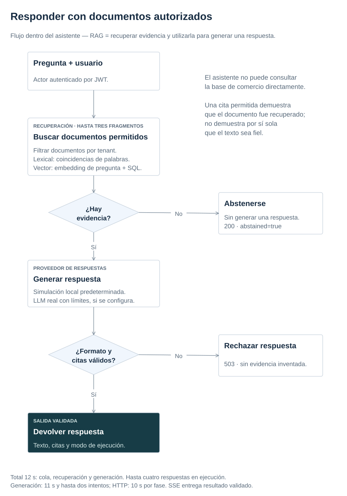

# 5. Buscar documentos y evaluar respuestas de IA

[← Anterior](events.md) · [Índice de la referencia](../index.md) · [Siguiente →](workflows.md)

Hasta aquí el pedido ha circulado entre servicios. Se incorpora ahora el asistente: antes de responder sobre una devolución debe buscar información que el usuario pueda consultar. Este capítulo separa esa búsqueda de la generación de texto.

**Objetivo:** entender RAG, comparar búsqueda léxica y vectorial e interpretar métricas de recuperación sin confundirlas con calidad generativa.

<a id="python-prerequisites"></a>

## Python necesario para seguir el ejemplo

Conviene reconocer anotaciones de tipos, `dataclass`, `Protocol` y `async`/`await`. Un `Protocol` describe las operaciones que necesita la aplicación sin imponer herencia a sus adaptadores; [ports.py](../../apps/ai-service/src/ai_service/application/ports.py) permite compararlo con una interfaz Java. Una función `async def` produce una operación esperable; `await` cede control mientras espera, no crea por sí solo otro proceso ni vuelve paralelo código bloqueante.

En [AnswerService.answer](../../apps/ai-service/src/ai_service/application/answers.py), seguir `timeout → Semaphore → search → generate`: el plazo rodea también la espera de capacidad. `async with` entra y sale de un contexto que libera recursos incluso al fallar o cancelar. Antes de continuar, explicar qué sucede cuando la búsqueda no encuentra documentos: se devuelve abstención sin llamar al generador. [test_answers.py](../../apps/ai-service/tests/test_answers.py) contrasta esa coordinación. Para sintaxis, consultar [Protocol](https://docs.python.org/3.12/library/typing.html#typing.Protocol), [corutinas y tareas](https://docs.python.org/3.12/library/asyncio-task.html) y [semáforos](https://docs.python.org/3.12/library/asyncio-sync.html#asyncio.Semaphore); aquí se usa Python 3.12.

<a id="topic-evidencia-antes-de-redactar"></a>

<a id="ref-topic-r18"></a>

## Buscar información antes de generar texto

Una respuesta fluida puede ser falsa. RAG (Retrieval-Augmented Generation, generación aumentada por recuperación) busca primero evidencia en documentos autorizados y después entrega esa evidencia al generador. Recuperar documentos y redactar una respuesta son dos pasos distintos; una base vectorial es una opción de recuperación, no un requisito de RAG. El corpus —el conjunto de documentos disponibles— es pequeño y ficticio: no hace falta comenzar por embeddings. El recuperador léxico de referencia permite aislar la calidad de recuperación del comportamiento generativo.

La búsqueda léxica compara términos normalizados de pregunta y documento: el recuperador cuenta palabras compartidas y desempata por ID. Por ejemplo, tras normalizar, la pregunta «plazo devolución» comparte dos términos con «La devolución tiene un plazo de 30 días» y ninguno con «Envío en 3 días». El primer documento obtiene más puntuación léxica. Es un ejemplo del ranking, no una respuesta generada.

Un embedding representa texto mediante un vector numérico; la variante vectorial ordena por distancia coseno, con valores menores primero. La distancia coseno compara la orientación de los vectores para estimar su similitud. Puede encontrar cercanía sin compartir palabras, pero esa cercanía no acredita permisos ni verdad. Los documentos actuales ya son breves: no existe aquí una ingesta automática que divida archivos en fragmentos (chunks).

El [recuperador](../../apps/ai-service/src/ai_service/infrastructure/retrieval.py) filtra por organización (tenant) antes de seleccionar los tres documentos más relevantes. El tenant procede del JWT validado. No se recupera de todos los usuarios para filtrar después de generar: el contenido ya habría cruzado una frontera de seguridad. No hay endpoint público de subida de documentos ni caché compartida entre tenants.

[](../diagrams/answer-flow.svg)

[AnswerService](../../apps/ai-service/src/ai_service/application/answers.py) conoce los puertos de recuperación y generación. Los adaptadores concretos se ensamblan en la entrada FastAPI. Una respuesta solo puede citar identificadores realmente recuperados; una cita existente no demuestra que el texto esté respaldado semánticamente. Esa segunda propiedad necesita evaluación del modelo y revisión del contenido.

<a id="topic-simulacion-y-proveedor-real"></a>

<a id="ref-topic-r19"></a>

## Comparar la simulación con el proveedor real

`fake` es el modo predeterminado y se identifica en la respuesta. Hace el entorno reproducible sin claves ni gasto; verifica integración, permisos, formato y flujo de errores. No acredita calidad, seguridad lingüística ni coste de un modelo real.

Un prompt es la entrada preparada para el modelo: instrucciones, pregunta y documentos. Los modelos procesan texto en fragmentos llamados tokens; su tamaño depende del modelo y no coincide necesariamente con palabras. Estos tokens son unidades de texto, distintos del token de acceso que acredita la identidad.

El adaptador OpenAI usa Responses con salida estructurada, modelo explícito y límite de salida. Antes de considerar la operación correcta valida el sobre JSON y su contenido: `answer` textual, `abstained` booleano y citas de documentos suministrados. Un HTTP 200 con JSON inválido produce 503 y cuenta como fallo, sin reintentar ese contenido. El servicio conserva la autorización por organización; el adaptador no la decide.

Los plazos, intentos y el circuito de protección limitan el daño de un fallo; el [capítulo 7](security.md) desarrolla esos controles. En `OpenAIProvider`, seguir la validación del resultado antes del registro de éxito; [test_providers.py](../../apps/ai-service/tests/test_providers.py) comprueba que una prueba de recuperación inválida no cierra el circuito.

<details markdown="1">
<summary>Qué limita el presupuesto del proveedor</summary>

El plazo total incluye la espera en cola; generar y realizar hasta dos intentos debe caber dentro del tiempo disponible. El proveedor real exige presupuesto declarado y límite de solicitudes. Ese presupuesto en USD no es un contador de facturación: comprobar precios, tokens de entrada y tarifas del modelo antes de una evaluación real. El cupo se aplica por adaptador/proceso y se reinicia al arrancar; generación y embeddings llevan contadores distintos, sin presupuesto global persistente.

</details>

La variante pgvector valida dimensión de embeddings y filtra tenant en SQL antes de ordenar por distancia. Los tests usan vectores de prueba contra PostgreSQL/pgvector real para verificar aislamiento y orden, sin pagar embeddings. La ingesta de un corpus con embeddings reales requiere configuración deliberada. Búsqueda léxica y vectorial deben compararse sobre las mismas preguntas; una variante híbrida sería una ampliación posterior. La consulta concreta ordena por `embedding <=> vector` con filtro de tenant y dimensión; no demuestra un índice aproximado ANN ni rendimiento con un corpus grande. [test_vector.py](../../apps/ai-service/tests/test_vector.py) comprueba aislamiento, orden y dimensión con vectores sintéticos. Un índice vectorial no garantiza mejores respuestas; aproximar vecinos también exige medir qué evidencia se pierde.

<a id="topic-que-medir"></a>

<a id="ref-topic-r20"></a>

## Medir la recuperación de documentos

El [dataset](../../apps/ai-service/data/evaluation.json) incluye preguntas respondibles, ausencia de evidencia, accesos cruzados e instrucciones maliciosas. Los identificadores relevantes se etiquetan explícitamente. Recall@3 mide qué proporción de documentos relevantes aparece en los tres recuperados, para casos respondibles. Hit-rate@3 indica si apareció al menos un relevante; MRR@3 promedia el inverso del puesto del primer relevante. Por ejemplo, si A y B son relevantes y se recuperan `[C, A, D]`, recall@3 es 1/2, hit-rate@3 es 1 y el rango recíproco es 1/2 porque el primer relevante ocupa la segunda posición. MRR promedia ese rango recíproco; un caso respondible sin relevante recuperado aporta cero. Abstenciones y aislamiento se reportan por separado; no se mezclan para inflar una media.

La evaluación es pequeña, sintética y cercana al corpus. Una puntuación perfecta no implica generalización. Para un modelo real añadir fidelidad a evidencia, corrección de citas, abstención apropiada, latencia p95, tokens y coste por tarea completada. Conservar modelo, versión de prompt, dataset y juicio humano. Un juez LLM puede ayudar, pero hereda sesgos y no sustituye pruebas deterministas de permisos.

<a id="topic-evaluar-respaldo-de-respuestas"></a>

<a id="ref-topic-r21"></a>

## Evaluar si la respuesta está respaldada

Ejercicio sin modelo: usar este extracto preparado, identificado como `policy-study`: «El plazo de devolución es de 30 días desde la entrega. El producto debe estar sin usar y conservar su embalaje». No sustituye el corpus ni mide un proveedor real.

Para la pregunta «¿Qué plazo tengo y en qué condiciones?», juzgar las siguientes respuestas antes de abrir la explicación. Las tres citan `policy-study`:

| Respuesta preparada | Cita |
|---|---|
| A. «30 días desde la entrega; sin usar y con embalaje» | `policy-study` |
| B. «90 días desde la entrega; sin usar y con embalaje» | `policy-study` |
| C. «30 días desde la entrega; sin usar, con embalaje y abono en 24 horas» | `policy-study` |

**Rúbrica:** (1) descomponer la respuesta en afirmaciones y localizar su respaldo; (2) comprobar que la cita es pertinente y no solo existente; (3) responder únicamente a lo respaldado y reconocer lo que falta. Una contradicción o una afirmación inventada impide aprobar, aunque las demás sean correctas.

<details markdown="1">
<summary>Ver el diagnóstico y cuándo abstenerse</summary>

| Respuesta | Respaldo de las afirmaciones | Pertinencia de la cita |
|---|---|---|
| A | Todas respaldadas | Apoya plazo y condiciones |
| B | Contradice el plazo | El ID existe, pero no respalda 90 días |
| C | Inventa el plazo de abono | Solo apoya parte de la respuesta |

La primera respuesta cumple la rúbrica para esa pregunta. Las otras fallan en generación: la evidencia necesaria estaba disponible. Si no se hubiera recuperado el plazo, habría que investigar primero recuperación o corpus. Ante «¿cuándo recibiré el dinero?», este extracto no permite responder: debe indicarse que falta información; en la referencia, ausencia de documentos recuperados provoca abstención sin generar.

</details>

Para comparar modelos en el futuro, mantener las mismas preguntas reservadas —distintas de las usadas para ajustar prompts— y esta rúbrica. Elegir primero un mínimo de calidad y permisos; después comparar latencia y coste por tarea válida. Estos ejemplos preparados enseñan el juicio, sin atribuir puntuaciones a modelos ni ejecutar una API.

## Enviar el resultado mediante SSE

SSE (Server-Sent Events) mantiene una respuesta HTTP abierta para enviar eventos del servidor al cliente. Aquí emite inicio y un resultado completo ya validado. Permite enseñar conexión, terminación y cancelación sin permitir acciones a partir de texto parcial. No es streaming token a token. Desconectar cancela la tarea y libera capacidad para otra petición. La prueba utiliza ASGI, la interfaz entre el servidor y la aplicación Python, para simular esa desconexión. Un cliente debe distinguir un evento `error` de una respuesta válida.

<a id="practica-guiada-interpretar-el-ranking-de-documentos"></a>
<a id="práctica-guiada-interpretar-el-ranking-de-documentos"></a>

## Comprobación reproducible: interpretar el ranking de documentos

### 1. Seguir el código

Leer el recuperador enlazado, [evaluate.py](../../apps/ai-service/src/ai_service/evaluate.py) y [test_evaluate.py](../../apps/ai-service/tests/test_evaluate.py). Desde la raíz:

### 2. Predecir el resultado

Si A y B son relevantes y se recuperan C, A y D, ¿qué valores tendrán recall, hit-rate y rango recíproco? Anotar una respuesta antes de ejecutar los comandos.

### 3. Ejecutar y comparar

```bash
make eval
make eval EVAL_REPORT=reports/ai-evaluation.json
(cd apps/ai-service && uv run pytest tests/test_evaluate.py tests/test_answers.py -q)
```

**Qué observar en el dataset incluido:** 42 casos, 32 respondibles, recall@3 e hit-rate@3 de 1 y MRR@3 de 0,953125. Son mediciones de recuperación offline, sin evaluar modelo real. La prueba multirrelevancia fuerza una recuperación incompleta y distingue recall de hit-rate; otra rechaza una cita no recuperada. Las pruebas rápidas no incluyen PostgreSQL: `make verify` también comprueba pgvector real.

El informe JSON es opcional y queda excluido de Git: identifica versión de esquema, hashes SHA-256 del dataset/corpus y alcance `offline-retrieval-only`. Cada caso conserva un ID estable, documentos esperados/recuperados y métricas; localizar un `mrrAt3 < 1` permite revisar el ranking que explica el agregado. Los casos sin evidencia llevan métricas de recuperación nulas, con aislamiento y abstención por separado. Solo se aceptan archivos dentro de `reports/` del repositorio, sin escapes por rutas o enlaces simbólicos. Si la evaluación no alcanza los mínimos, el informe solicitado también se guarda para poder investigar el fallo. El informe mide recuperación léxica, no fidelidad de una respuesta generada.

**Alternativa:** comparar embeddings o búsqueda híbrida con las mismas etiquetas, sin asumir que mayor complejidad mejora resultados. Antes de cambiar el ranking, preguntar si el problema es ausencia de evidencia, orden de documentos o fidelidad de generación: requieren controles distintos.

<a id="topic-ejercicio-caso-de-recuperacion"></a>

<a id="ejercicio-de-aplicacion-anadir-una-pregunta-propia"></a>
<a id="ejercicio-de-aplicación-añadir-una-pregunta-propia"></a>

## Caso de aplicación: añadir una pregunta propia

Crear un caso de estudio en memoria, sin cambiar los 42 casos de referencia: tenant `demo` y pregunta «¿Es obligatorio conservar el embalaje?». Leer el [corpus](../../apps/ai-service/data/corpus.json), elegir el documento relevante y predecir si se recuperará y por qué. Desde la raíz, con Python/uv, completar la lista `relevant` antes de ejecutar:

```bash
uv run --project apps/ai-service python - <<'PYTHON'
import asyncio
from pathlib import Path
from ai_service.infrastructure.retrieval import LexicalRetriever
from ai_service.evaluate import retrieval_scores

case = {"question": "¿Es obligatorio conservar el embalaje?", "relevant": []}
async def run():
    retriever = LexicalRetriever(Path("apps/ai-service/data/corpus.json"))
    documents = await retriever.search("demo", case["question"])
    ids = [document.id for document in documents]
    print(ids)
    print(retrieval_scores(case["relevant"], ids))
asyncio.run(run())
PYTHON
```

**Pista:** etiquetar según el contenido del documento y después buscar los términos comunes con la pregunta. La lista vacía es deliberada: sin etiqueta relevante no se pueden calcular estas métricas y el programa debe rechazarla. Terminado cuando la etiqueta procede del contenido y se explican los tres resultados; después proponer otra formulación y analizar su ranking, sin cambiar etiquetas para ocultar un fallo.

<details markdown="1">
<summary>Ver una resolución razonada del caso inicial</summary>

Completar `"relevant": ["demo-returns"]`. Se espera `['demo-returns']` y recall, hit-rate y MRR de 1 para este caso. Coinciden «conservar» y «embalaje»; no hace falta un embedding. El resultado acredita esa recuperación, no una respuesta generada ni generalización. Si una nueva formulación no comparte términos, explicar la limitación léxica antes de cambiar el recuperador.

</details>

<a id="exercise-python-provider"></a>

## Microejercicio Python: cancelar un proveedor sin perder capacidad

**Tiempo activo:** 20–30 minutos; preparar Python 3.12 y `uv sync` puede requerir tiempo adicional. Sin Docker, claves ni modelo real. Trabajar en una copia de estudio y añadir `tests/test_provider_exercise.py`; restaurarla al terminar.

**Objetivo:** implementar un objeto compatible con [`AnswerProvider`](../../apps/ai-service/src/ai_service/application/ports.py) sin heredar del protocolo. Su `generate` debe señalar que ha empezado, esperar un `asyncio.Event` y señalar limpieza en `finally`. Conectarlo a `AnswerService` y al recuperador léxico real.

**Antes de escribir:** predecir cuántos cupos quedan de los cuatro del servicio mientras una llamada espera; qué excepción debe propagarse al cancelarla; y si una llamada posterior podrá responder. No usar `sleep` para adivinar cuándo ha empezado.

**Pista:** crear tres eventos (`started`, `release`, `cleaned`), esperar `started` con timeout y cancelar la tarea. El `async with` del semáforo debe liberar su permiso al propagarse `CancelledError`. El deadline se recibe como argumento, aunque el falso no realiza IO externo. Un `Protocol` describe estructura para el comprobador de tipos; la anotación no valida el objeto en ejecución.

<details markdown="1">
<summary>Ver solución y comprobación</summary>

```python
import asyncio
from pathlib import Path
import pytest
from ai_service.application.answers import AnswerService
from ai_service.application.ports import AnswerProvider
from ai_service.domain import Document, Principal
from ai_service.infrastructure.retrieval import LexicalRetriever

class BlockingProvider:
    mode = "fake-simulation"

    def __init__(self):
        self.started = asyncio.Event()
        self.release = asyncio.Event()
        self.cleaned = asyncio.Event()

    async def generate(self, question: str, documents: list[Document], *,
                       deadline: asyncio.Timeout | None = None) -> dict:
        self.started.set()
        try:
            await self.release.wait()
            return {"answer": "Respuesta sintética", "citations": [documents[0].id],
                    "abstained": False}
        finally:
            self.cleaned.set()

@pytest.mark.asyncio
async def test_provider_cancellation_releases_capacity():
    provider = BlockingProvider()
    port: AnswerProvider = provider
    service = AnswerService(port, LexicalRetriever(Path("data/corpus.json")))
    actor = Principal("alice", "demo", frozenset({"CUSTOMER"}))
    task = asyncio.create_task(service.answer(actor, "devolución plazo"))
    try:
        await asyncio.wait_for(provider.started.wait(), timeout=1)
        assert service.capacity._value == 3
        task.cancel()
        with pytest.raises(asyncio.CancelledError):
            await task
        assert provider.cleaned.is_set()
        assert service.capacity._value == 4
        provider.release.set()
        result = await service.answer(actor, "devolución plazo")
        assert result["citations"]
        assert service.capacity._value == 4
    finally:
        task.cancel()
        await asyncio.gather(task, return_exceptions=True)
```

Desde la raíz de la copia:

```bash
(cd apps/ai-service && uv run pytest tests/test_provider_exercise.py -q)
```

Se espera una prueba aprobada. `_value` es un detalle interno del semáforo que aquí se inspecciona solo en la prueba, como en la regresión existente; no es una API para lógica de negocio. La segunda llamada demuestra que el servicio sigue utilizable. El `finally` de la prueba recoge la tarea incluso si una aserción falla.

</details>

**Terminado:** explicar por qué el `finally` del proveedor y la salida del semáforo tienen responsabilidades diferentes, y por qué capturar `CancelledError` sin propagarlo rompería esta expectativa. Comparar con [test_answers.py](../../apps/ai-service/tests/test_answers.py), que cubre además ocho llamadas y el deadline en cola.

<a id="documentacion-del-capitulo"></a>
<a id="documentación-del-capítulo"></a>

## Documentación de la sección

[Responses](https://platform.openai.com/docs/api-reference/responses), [salidas estructuradas](https://developers.openai.com/api/docs/guides/structured-outputs), [pgvector: distancias y consultas](https://github.com/pgvector/pgvector#querying), [FastAPI respuestas](https://fastapi.tiangolo.com/advanced/custom-response/).

<a id="topic-lectura-y-ejemplo-de-referencia"></a>

## Para profundizar

**Primero:** [AI Engineering, capítulo 6](../bibliography.md#book-b12), centrando la consulta en recuperación y RAG. **Alternativa:** [Architecture Patterns with Python, capítulo 4](../bibliography.md#book-b11), para comparar la coordinación de aplicación con AnswerService. Terminado cuando se separan ausencia de evidencia, ranking y fidelidad de generación. [Correspondencias de recuperación](../bibliography.md#chapters-retrieval). [La guía de recuperación de LlamaIndex](https://github.com/run-llama/llama_index/blob/8469a034226d20b70a667dc7faf013770716709f/docs/examples/low_level/retrieval.ipynb) permite seguir recuperación, selección del contexto y consulta. Comparar qué decide el recuperador con lo que decide el generador; los filtros de autorización de esta referencia siguen siendo obligatorios. La bibliografía enlaza por separado evaluación de recuperación y respaldo semántico; consultar ese tramo ante una duda concreta.

<a id="comprobar-lo-aprendido"></a>

## Pregunta de diseño

Se recupera el documento correcto, pero la respuesta contradice su contenido. ¿Qué habría que evaluar para detectar ese fallo?

<details markdown="1">
<summary>Ver la explicación</summary>
<p>El respaldo semántico de la respuesta en la evidencia: si sus afirmaciones concuerdan con los documentos. Recall solo mide qué documentos se han recuperado y no descubre esa contradicción.</p>
</details>

Buscar información permite responder preguntas; una devolución necesita además permisos y coordinación. Ese es el siguiente paso.

---

[← 4. Publicar eventos y procesarlos con Kafka Streams](events.md) · [Índice](../index.md) · [6. Coordinar una devolución con aprobación →](workflows.md)
