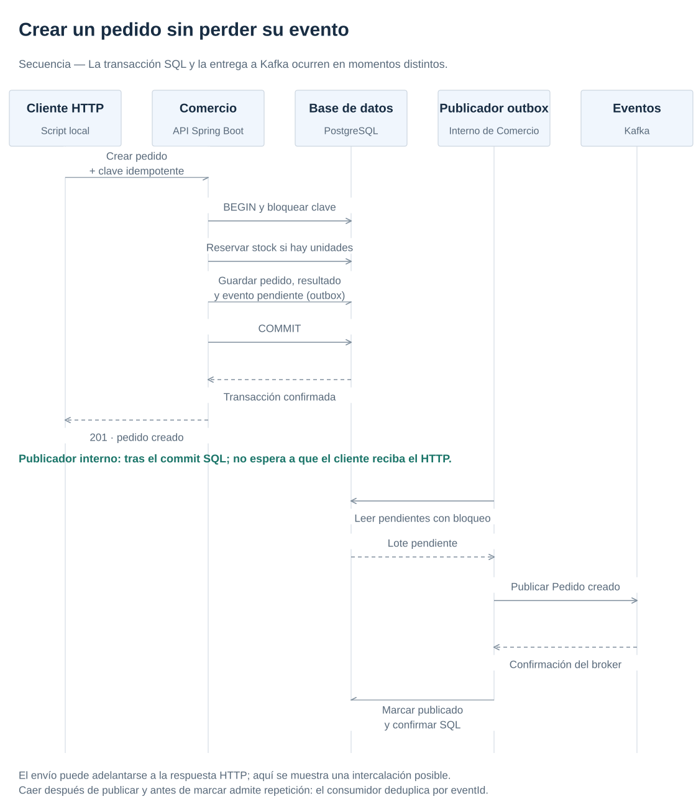
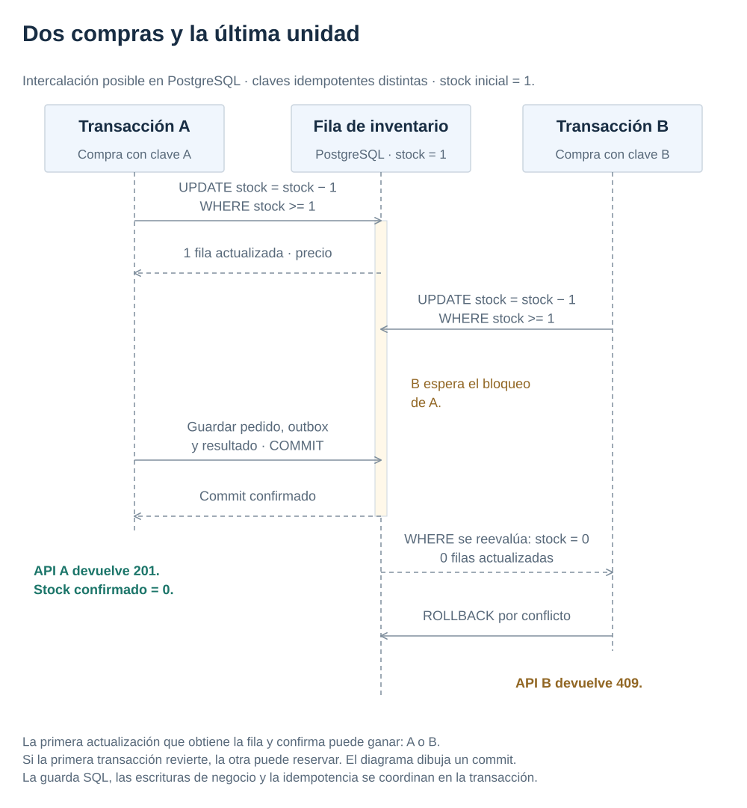
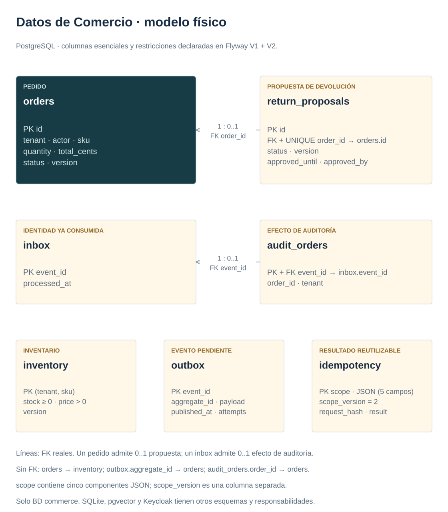

# 3. Proteger datos con transacciones e idempotencia

[← Anterior](api-contracts.md) · [Índice del manual](../index.md) · [Siguiente →](events.md)

El capítulo 2 definió el contrato de compra. Ahora se comprueba qué garantiza el backend cuando dos peticiones llegan a la vez o cuando el cliente repite una compra tras perder la respuesta.

**Objetivo:** explicar por qué la última unidad solo se vende una vez y cómo se recupera el resultado de una petición repetida.

<a id="topic-la-invariante-primero"></a>

## Evitar que dos pedidos vendan la misma unidad

Una transacción agrupa cambios para confirmarlos juntos (commit) o deshacerlos si fallan (rollback). La atomicidad significa que no quedan cambios a medias. Su aislamiento define cómo interactúa con otras transacciones simultáneas.

Dos compradores pueden consultar el inventario al mismo tiempo y ver que queda una unidad. Si ambos restan en memoria y guardan cero, se venden dos unidades aunque el contador parezca correcto. Cada pedido aceptado debe corresponder a una reserva efectiva, sin stock negativo. Esa condición que siempre debe cumplirse es una invariante del negocio. Una transacción no arregla por sí sola una secuencia de lecturas y escrituras mal diseñada.

El [adaptador de inventario](../../apps/commerce-api/src/main/java/dev/reference/commerce/inventory/infrastructure/persistence/JdbcInventoryRepositoryAdapter.java) usa una actualización condicional: descontar solo si `stock >= quantity`, comprobando filas afectadas. PostgreSQL coordina escrituras concurrentes sobre la misma fila. La reserva, el pedido, el registro idempotente y el evento outbox se confirman en una transacción local. Precio e importe se calculan en servidor; el cliente no puede enviar un total arbitrario.

[](../diagrams/order-sequence.svg)

<a id="topic-dos-peticiones-y-la-ultima-unidad"></a>

## Dos peticiones y la última unidad

La siguiente secuencia muestra una intercalación posible con Read Committed, el aislamiento predeterminado de PostgreSQL. La segunda actualización espera el bloqueo de la fila; después del commit de la primera, PostgreSQL vuelve a evaluar `stock >= quantity` sobre la fila actualizada. Sin unidades disponibles, no devuelve filas y el adaptador produce un conflicto. Si la primera transacción revierte, la segunda puede reservar.

[](../diagrams/stock-concurrency.svg)

El ejemplo usa dos compras con claves distintas. Un reintento de la misma clave se serializa antes mediante idempotencia; recuperar su resultado evita reservar otra vez.

## Esquema que sostiene las garantías

[](../diagrams/commerce-data.svg)

PK identifica una fila; FK exige una referencia existente. La cardinalidad se lee izquierda:derecha: un pedido tiene cero o una propuesta y cada propuesta corresponde a un pedido. Solo se dibujan las dos FK declaradas en Flyway; las referencias lógicas sin FK se enumeran aparte.

<a id="topic-repetir-una-peticion-es-normal"></a>

## Recuperar el resultado al repetir una petición

El cliente puede perder la respuesta después del commit. Repetir la solicitud no debería duplicar pedido ni reserva. `Idempotency-Key` identifica la intención del cliente, dentro del tenant, actor, operación y recurso. Se almacena también el hash del cuerpo: reutilizar una clave para otra intención produce 409. La misma intención recupera el resultado anterior. La identidad del actor viene del JWT, no del JSON.

El puerto recibe un ámbito estructurado y el [adaptador idempotente](../../apps/commerce-api/src/main/java/dev/reference/commerce/shared/infrastructure/persistence/JdbcIdempotencyAdapter.java) lo codifica como array JSON. Concatenar con `:` permitiría confundir componentes legítimos. La versión V2 rechaza migrar si hay claves antiguas ambiguas: no las borra ni permite repetir efectos con otro prefijo; [ADR002](../decisions/002-consistency.md) explica el límite y el reset sintético explícito.

La implementación hace esperar dentro de PostgreSQL a las solicitudes que comparten clave y guarda el resultado en la misma transacción del efecto. Una caché en memoria no bastaría ante reinicios o varias réplicas. Tampoco basta comprobar «si existe» y luego insertar sin una restricción o un mecanismo de exclusión: dos transacciones podrían pasar la comprobación.

La devolución tiene una invariante semejante. Una aprobación se vincula a la versión y al contenido de una propuesta, con caducidad. La ejecución comprueba de nuevo estado, versión y fecha dentro de la transacción; registra devolución, cambia pedido y repone inventario una sola vez. Una respuesta perdida se recupera con una clave estable de ejecución. Se trata de un reembolso sintético: no hay transferencia de dinero ni transacción con un proveedor de pagos.

## Alternativas y costes

Bloquear la fila antes de decidir puede simplificar reglas más complejas; aumenta el tiempo de espera y exige orden consistente de bloqueos. Una versión optimista sirve cuando los conflictos son infrecuentes y el cliente puede reintentar. La actualización condicional expresa bien este caso pequeño. No se escoge un nivel de aislamiento más costoso por costumbre: se razona sobre anomalías concretas y se prueba la invariante.

Mantener inventario y pedidos en la misma base evita una transacción distribuida. Si fueran servicios independientes, la reserva necesitaría protocolo, estado intermedio, caducidad y compensación. Una saga coordina esas etapas, pero no ofrece el rollback instantáneo de una transacción SQL.

## Práctica guiada: comprobar reserva, repetición y rollback

### 1. Seguir el código

Seguir el adaptador de inventario y el idempotente enlazados, después [CommerceIntegrationTest](../../apps/commerce-api/src/test/java/dev/reference/commerce/CommerceIntegrationTest.java). Desde la raíz, con Java 21 y Docker:

### 2. Predecir el resultado

Hay una unidad y dos compradores distintos. ¿Qué debe quedar en stock y cuántos pedidos pueden confirmarse? Anotar una respuesta antes de ejecutar los comandos.

### 3. Ejecutar y comparar

```bash
(cd apps/commerce-api && \
  DOCKER_HOST="$(docker context inspect --format '{{.Endpoints.docker.Host}}')" \
  TESTCONTAINERS_DOCKER_SOCKET_OVERRIDE=/var/run/docker.sock \
  ./mvnw -B -ntp -Dapi.version=1.44 '-Dtest=CommerceIntegrationTest#priceAndIdempotency+concurrentLastUnit+rollbackIncludesStockAndOrder+subjectsWithDelimitersCannotShareCachedResultsEvenConcurrently' test)
```

**Qué observar:** las pruebas deben pasar utilizando PostgreSQL y Kafka temporales. Una clave repetida conserva el resultado; dos compradores no venden dos veces la última unidad. El fallo controlado añade temporalmente una restricción SQL que rechaza la escritura del outbox: deben quedar cero pedidos y stock intacto. La carrera con `:` conserva dos identidades distintas. No modifica volúmenes Compose.

**Alternativa:** mocks verifican coordinación, pero no prueban bloqueos ni aislamiento SQL. ¿Seguiría siendo una transacción local si inventario estuviera en otro servicio? Serían necesarios estados intermedios y compensación, no otra anotación.

En operación se debe definir retención de claves, volumen de outbox, tiempo de bloqueo y estrategia de migración compatible. No borrar registros idempotentes durante un plazo en el que clientes todavía puedan repetir solicitudes.

## Documentación del capítulo

[PostgreSQL: Read Committed y actualización concurrente](https://www.postgresql.org/docs/17/transaction-iso.html#XACT-READ-COMMITTED), [bloqueos explícitos](https://www.postgresql.org/docs/17/explicit-locking.html), [Spring transacciones](https://docs.spring.io/spring-framework/reference/data-access/transaction.html). Para profundizar en aislamiento y sistemas de datos, la [lectura DDIA recomendada en eventos](events.md#topic-lecturas-y-ejemplo-de-referencia) complementa este caso SQL.

## Comprobar lo aprendido

Si la primera transacción revierte mientras la segunda espera la fila, ¿la segunda tiene que devolver conflicto?

<details>
<summary>Ver la explicación</summary>
<p>No necesariamente. Tras el rollback puede volver a haber stock disponible. La actualización condicional de la segunda transacción puede reservarlo; lo decisivo es el estado confirmado de la fila.</p>
</details>

El pedido ya puede confirmarse de forma consistente en SQL. El siguiente paso es comunicarlo a otros procesos aunque Kafka falle.

---

[← 2. Definir contratos HTTP y paginar resultados](api-contracts.md) · [Índice](../index.md) · [4. Publicar eventos y procesarlos con Kafka Streams →](events.md)
