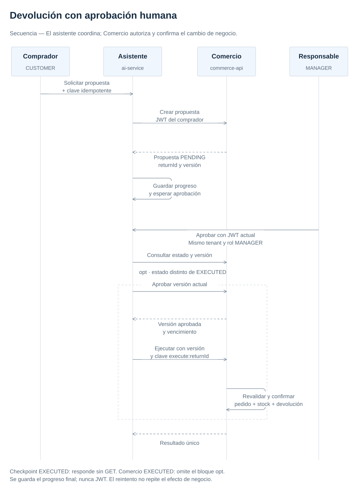
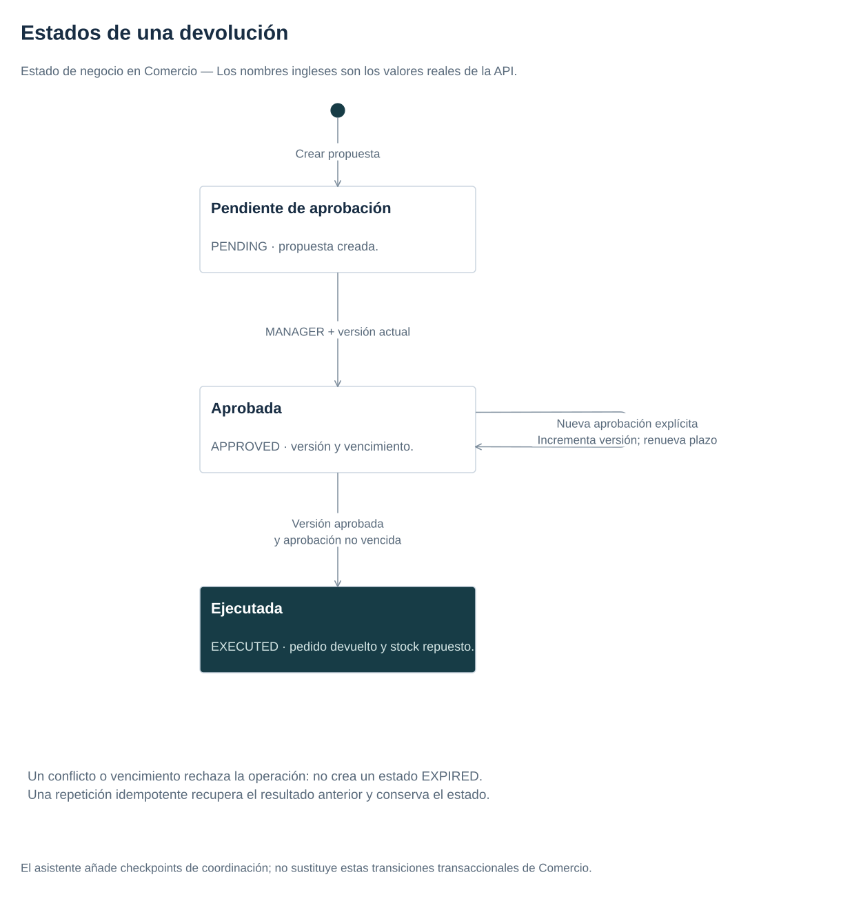

# Workflow persistente y aprobación de efectos

## Una propuesta no es un permiso

Recuperar una política o generar una recomendación no autoriza una devolución. La API de comercio conserva las reglas y comprueba al actor en cada operación. El workflow coordina pasos y recuerda progreso; no otorga roles ni escribe directamente en tablas de negocio.

Crear un workflow llama a comercio con el JWT del usuario y una clave idempotente. Comercio registra una propuesta PENDING para un pedido visible. El grafo persiste y se pausa. Un MANAGER del mismo tenant puede aprobar; otro tenant recibe 404 y un cliente sin rol recibe 403. Después se recupera la versión aprobada y se ejecuta con una clave estable derivada de la devolución.

[](../diagrams/return-sequence.svg)

[Maestro draw.io](../diagrams/architecture.drawio). Editar el `.drawio` con draw.io y volver a exportar el SVG.

El JWT se usa transitoriamente para la llamada y no se guarda en checkpoints. Guardarlo convertiría el almacén del workflow en una colección de credenciales reutilizables. La identidad de propietario y tenant sí debe persistir para controlar consultas y reanudaciones.

## Estado y fallo entre sistemas

[](../diagrams/return-states.svg)

[Maestro draw.io](../diagrams/architecture.drawio). Editar el `.drawio` con draw.io y volver a exportar el SVG.

Este diagrama describe el estado de negocio. Una nueva aprobación explícita cambia versión y vencimiento; no es una repetición idempotente de la misma aprobación. El vencimiento se verifica como condición de ejecución, sin un estado EXPIRED persistido. El grafo tiene además checkpoints de coordinación. No existe commit atómico entre la llamada HTTP y el checkpoint: comercio puede confirmar y la respuesta perderse. Al reintentar, la clave estable devuelve el efecto anterior. LangGraph no proporciona por sí solo «exactamente una ejecución» sobre sistemas externos.

La aprobación cambia versión. Ejecutar con la versión anterior debe fallar. Una propuesta aprobada no se edita silenciosamente; cualquier cambio requiere nueva aprobación. La caducidad de diez minutos limita una autorización que dejó de representar la intención actual. El backend aplica estos controles dentro de su transacción, incluso si se invoca sin pasar por AI.

## Persistencia y escalado

El [workflow](../../apps/ai-service/src/ai_service/infrastructure/workflows.py) usa SQLite y un proceso para que el ejemplo sea inspeccionable y persistente. El volumen permite reiniciar la aplicación. Un lock asyncio solo coordina tareas de ese proceso. No se puede añadir otra réplica y asumir exclusión distribuida.

Para varias réplicas se necesita un checkpointer compartido, registro idempotente durable y transición condicionada por versión/estado o bloqueo distribuido. Cambiar únicamente SQLite por PostgreSQL no resuelve carreras entre dos aprobaciones. Kubernetes conserva una réplica AI y escala el backend de comercio; la restricción está documentada antes del despliegue.

Un flujo determinista es suficiente aquí. Un agente autónomo tendría sentido si existieran decisiones abiertas justificadas y evaluables. Añadir herramientas aumenta superficie de autorización y riesgo; MCP estandariza intercambio, sin reemplazar permisos ni aislamiento.

## Comprobación

```bash
make demo
cd apps/ai-service && uv run pytest
cd ../commerce-api && ./mvnw verify
```

Los tests reconstruyen el workflow desde el mismo checkpoint tras cerrar el proceso, simulan pérdida de respuesta y comprueban que no aparece un JWT en el almacén. Comercio prueba versión, vencimiento y ejecución concurrente. El escenario integrado verifica permisos reales con Keycloak y que el stock vuelve una sola vez al valor anterior.

Fuentes: [LangGraph persistencia](https://docs.langchain.com/oss/python/langgraph/persistence), [interrupciones](https://docs.langchain.com/oss/python/langgraph/interrupts), [OWASP autorización](https://cheatsheetseries.owasp.org/cheatsheets/Authorization_Cheat_Sheet.html).
