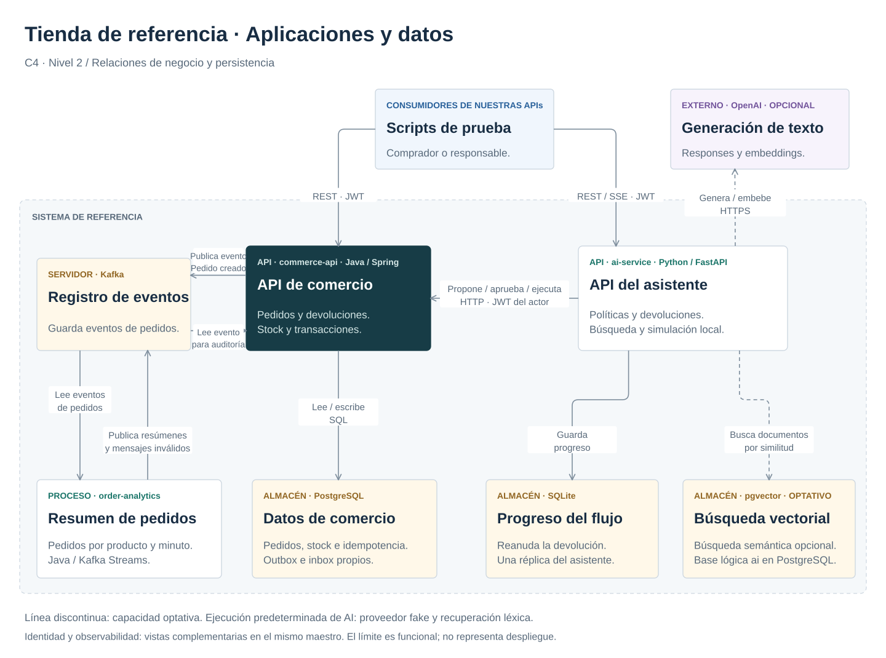

# Diseño del repositorio

Tres servicios, un dominio sintético y límites comprobables. La [especificación](specification.md) fija contratos; [aceptación](acceptance.md) define el resultado exigido y [verificación](verification.md) distingue implementación de evidencia. Esta página sustituye el diseño preliminar de dos servicios.

<a id="component-map"></a>

## Qué hace cada pieza

El ejemplo representa una tienda pequeña: crear un pedido reserva unidades de `BOOK-1`. Comercio guarda el pedido y un aviso pendiente en la misma transacción. Después publica el aviso en Kafka. El proceso de resúmenes lo lee y actualiza los totales por producto y minuto. El asistente responde preguntas sobre políticas y coordina una devolución que debe aprobar una persona autorizada; Comercio vuelve a comprobarla antes de modificar pedido y stock.

| Nombre funcional | Nombre en código o Compose | Qué es y para qué sirve |
|---|---|---|
| API de comercio | `commerce-api` | Aplicación Java con Spring Boot. Crea pedidos, protege stock y aprueba/ejecuta devoluciones. |
| API del asistente | `ai-service` | Aplicación Python con FastAPI. Recupera documentos, prepara respuestas y coordina el flujo de devolución mediante LangGraph. |
| Resumen de pedidos | `order-analytics` | Proceso Java con Kafka Streams. Lee eventos y cuenta pedidos creados por organización, producto y minuto. No calcula ventas netas tras devoluciones. |
| Registro de eventos | `kafka` | Servidor Apache Kafka. Conserva mensajes en canales llamados *topics*. Los productores publican; cada consumidor lleva su posición de lectura. Kafka Streams es una biblioteca del proceso de resúmenes, no otro servidor. |
| Servidor de identidad | `keycloak` | Aplicación independiente, ya construida por el proyecto Keycloak. Comprueba credenciales y emite tokens. Se levanta con el núcleo Compose; no es un módulo de Spring Boot ni código de negocio propio. |
| Scripts de prueba | `scenarios/`, `scenarios/smoke.py` | Programas que llaman a nuestras APIs actuando como comprador o responsable. Son *clientes HTTP*: no son otra API ni un conector hacia terceros. No hay interfaz web propia. |
| Datos de comercio | BD `commerce` / PostgreSQL | Pedidos, inventario y registros de idempotencia, outbox e inbox. Solo Comercio accede a estas tablas. |
| Progreso de devoluciones | SQLite / LangGraph | Archivo con puntos de reanudación del asistente. No es otra aplicación ni contiene los tokens de los usuarios. |
| Documentos vectoriales | BD `ai` / pgvector | Variante opcional para buscar documentos por similitud. Por defecto se buscan palabras en el corpus JSON incluido. |
| Proveedor de IA | OpenAI | Servicio externo optativo para generación y embeddings. La simulación `fake` vive dentro del asistente. |

**Aplicación, módulo y tecnología son niveles distintos.** `orders`, `inventory` y `returns` son módulos Java dentro de Comercio: comparten proceso y despliegue. Spring Boot y FastAPI son frameworks de aplicaciones. LangGraph y Kafka Streams son bibliotecas dentro de una aplicación. Keycloak y Kafka son servidores independientes. En C4, *contenedor* significa una aplicación o un almacén; no implica una conexión de red ni equivale necesariamente a un contenedor Docker.

**Identidad sin siglas implícitas.** OIDC (*OpenID Connect*) es un protocolo de identidad. JWT es el formato del token firmado que envía el cliente. JWKS es el formato de las claves públicas que las APIs descargan y guardan temporalmente para comprobar la firma. Cada API valida token, organización y permisos localmente; el servidor de identidad no decide por ella si una devolución es admisible. En el laboratorio se usa un login automatizable con credenciales sintéticas; las limitaciones están en [seguridad](handbook/security.md).

Los diagramas usan el nombre funcional como título y el identificador técnico en segundo plano. Los nombres ingleses de servicios, rutas HTTP, eventos y configuración se conservan para que los comandos y los contratos sigan correspondiendo al código.

## Estructura y responsabilidades

```text
apps/commerce-api/       Java: pedidos, inventario y devoluciones
apps/order-analytics/    Java: Kafka Streams, deduplicación y ventanas
apps/ai-service/         Python: recuperación, Responses y workflow
contracts/events/       Esquemas versionados y fixtures sintéticos
contracts/http/         OpenAPI canónico y verificación HTTP
scenarios/              Escenarios HTTP autenticados verificables
infra/local/            OIDC y bases locales
infra/observability/    Métricas, trazas, dashboard y alertas
infra/kubernetes/       Laboratorio kind, dedicado y local
infra/cloud/            Fundación GCP, Terraform validado con mocks
docs/handbook/          Explicaciones enlazadas al código
docs/decisions/         ADR y alternativas
scripts/               Automatización explícita y acotada
```

Commerce mantiene las invariantes y es dueño exclusivo de su base. AI consume sus contratos HTTP; nunca modifica tablas de comercio. El proceso de resúmenes interpreta hechos publicados, sin convertirse en fuente de verdad del inventario. Las tres aplicaciones se construyen por separado, sin compartir entidades entre lenguajes.

## C4: contexto, nivel 1

[](diagrams/c4-context.svg)

[Maestro draw.io](diagrams/architecture.drawio). Editar el `.drawio` con draw.io y volver a exportar el SVG.

## C4: contenedores, nivel 2

Aquí «contenedor» significa aplicación o almacén en [C4](https://c4model.com/diagrams/container), sin exigir Docker. El límite representa el sistema funcional; identidad y observabilidad se muestran en vistas complementarias como sistemas de apoyo, aunque se ejecuten localmente. No representa un perímetro de seguridad ni una topología de despliegue.

[](diagrams/c4-containers.svg)

[Abrir SVG a tamaño completo](diagrams/c4-containers.svg) · [Maestro editable draw.io](diagrams/architecture.drawio). Editar el `.drawio` con draw.io y volver a exportar el SVG. El maestro contiene trece páginas editables; cada SVG se exporta desde su página. No se mantienen fuentes independientes de la misma vista.

La vista contrasta `compose.yaml`, la [composición de AI](../apps/ai-service/src/ai_service/main.py), el [publicador outbox](../apps/commerce-api/src/main/java/dev/reference/commerce/shared/infrastructure/messaging/OutboxPublisher.java), el [consumidor de auditoría](../apps/commerce-api/src/main/java/dev/reference/commerce/shared/infrastructure/messaging/AuditConsumer.java) y la configuración de [trazas](../infra/observability/collector.yaml), [métricas](../infra/observability/prometheus.yaml) y [datasources](../infra/observability/datasources.yaml).

- **Negocio:** la API de comercio conserva las invariantes y sus tablas. AI invoca su API con el JWT del actor; LangGraph es una biblioteca interna, no otro servicio. Analytics consume pedidos y publica agregados/DLT mediante Kafka.
- **Identidad** ([vista de tokens y JWKS](diagrams/c4-identity.svg)): los clientes solicitan tokens a Keycloak; ambas APIs obtienen JWKS y validan JWT localmente. No hay autorización delegada al LLM ni una llamada a Keycloak por cada petición. El Compose local usa HTTP para Keycloak; la vista no representa un despliegue de producción. Se omiten los detalles internos del sistema de identidad.
- **Datos:** el corpus JSON está integrado en AI. SQLite persiste checkpoints; pgvector es una recuperación optativa. Las BD lógicas `commerce`, `ai` y `keycloak` comparten una instancia PostgreSQL local con usuarios separados. RocksDB pertenece al proceso Streams y se recupera mediante changelog.
- **Capacidades optativas:** generación/embeddings reales necesitan configuración explícita; la ejecución predeterminada usa `fake` y recuperación léxica. La [vista de observabilidad](diagrams/c4-observability.svg) agrupa las tres aplicaciones y distingue exportación de trazas (Commerce y AI), extracción de métricas (las tres) y consultas de Grafana.

Las 14 relaciones del C4 anterior se conservan: 11 en la vista principal y tres en identidad. La observabilidad añade cinco interacciones agrupadas a partir de su configuración. Separar estas vistas permite leer negocio y datos sin cruzar sus rutas con JWKS o señales. Los nombres funcionales son el título; los identificadores de aplicación y tecnologías quedan como detalle. Las réplicas, probes, HPA y la infraestructura Terraform corresponden a la [vista de operación y despliegue](handbook/delivery.md), no a este nivel C4.

### Dónde aparece cada responsabilidad en el código

| Responsabilidad | Punto de entrada o contrato |
|---|---|
| Recibir HTTP por módulo | [OrderController](../apps/commerce-api/src/main/java/dev/reference/commerce/orders/infrastructure/rest/OrderController.java), [InventoryController](../apps/commerce-api/src/main/java/dev/reference/commerce/inventory/infrastructure/rest/InventoryController.java), [ReturnController](../apps/commerce-api/src/main/java/dev/reference/commerce/returns/infrastructure/rest/ReturnController.java) |
| Crear, consultar y actualizar el estado de pedidos | [ManageOrderService](../apps/commerce-api/src/main/java/dev/reference/commerce/orders/application/service/ManageOrderService.java) |
| Crear, aprobar y ejecutar una devolución | [ManageReturnService](../apps/commerce-api/src/main/java/dev/reference/commerce/returns/application/service/ManageReturnService.java) |
| Resumir pedidos creados por ventana | [OrderSummaryTopology](../apps/order-analytics/src/main/java/dev/reference/analytics/OrderSummaryTopology.java) |
| Buscar evidencia y preparar la respuesta | [AnswerService](../apps/ai-service/src/ai_service/application/answers.py); puertos [DocumentRetriever y AnswerProvider](../apps/ai-service/src/ai_service/application/ports.py) |
| Coordinar la aprobación y reanudar una devolución | [ReturnApprovalWorkflow](../apps/ai-service/src/ai_service/infrastructure/workflows.py) |
| Verificar un token con claves públicas | [JwtVerifier](../apps/ai-service/src/ai_service/infrastructure/security.py) |

Los nombres técnicos expresan la responsabilidad: gestionar el ciclo de una devolución no se denomina únicamente «crear», y resumir pedidos no se denomina genéricamente «analytics». Los identificadores de despliegue permanecen estables; no hay otro servicio por cada clase de esta tabla.

## Convención Java

Las aplicaciones Java comparten raíz `dev.reference` (`commerce` y `analytics`); sus contratos de despliegue permanecen estables. Cada módulo funcional usa `domain`, `application/model`, `application/port/input`, `application/port/output`, `application/service` e `infrastructure`. Los adaptadores se agrupan por responsabilidad: `rest`, `persistence`, `messaging`, `security` y `config` cuando corresponde. Los adaptadores implementan puertos de salida; controladores invocan puertos de entrada. El dominio no conoce Spring, HTTP, SQL ni Kafka. Se admite Spring transaccional en aplicación para mantener visible la frontera real de commit. La estructura se comprueba con ArchUnit, no solo con nombres de directorios.

Las interfaces representan responsabilidades reemplazables. No se crea una interfaz por clase ni un servicio independiente por entidad. `shared` conserva actor, Quantity, errores semánticos, idempotencia y publicación; los controladores de negocio pertenecen a su módulo. Domain no contiene códigos HTTP: ProblemAdvice traduce Kind a status en infraestructura. Python expresa puertos con `Protocol`, sin replicar todas las capas de Java. CommerceGateway ofrece crear, consultar, aprobar y ejecutar devolución; ReturnResult es un resultado tipado, sin Response ni rutas HTTP.

## Entregas y puertas de calidad

| Paso | Implementar | Validar antes de avanzar |
|---|---|---|
| 0 | Contratos, amenazas y AC | Inputs, errores y evidencia definida |
| 1 | Pedido y stock atómico | Concurrencia, rollback, idempotencia, límites |
| 2 | Outbox, auditoría e inbox | Broker caído, duplicados y DLT |
| 3 | Kafka Streams | Ventanas, tardíos, dedup, reconstrucción |
| 4 | RAG y proveedor controlado | Dataset, aislamiento, abstención, fallos |
| 5 | Devolución aprobada | Permisos, versión, expiración y restart |
| 6 | Compose y observabilidad | Smoke completo, persistencia y señales |
| 7 | kind y Terraform | Rollout/HPA local y mocks sin cloud |
| 8 | Manual, ADR y CI | Build estricto, diagramas y comandos |
| 9 | Revisión independiente | Corregir hallazgos, puntuar con evidencia |

Cada entrega sigue contrato → implementación → pruebas y fallos → explicación → revisión → reparación. Máximo dos rondas por revisión: un hallazgo material abierto mantiene el estado incompleto. La implementación puede hacerse en paralelo cuando los contratos sean estables; la aceptación se verifica sobre el sistema integrado.

## Presentación y límites

Español para explicación; inglés para identificadores y nombres. La documentación describe decisiones y resultados, sin narrativa personal ni afirmaciones de experiencia industrial. Datos y usuarios son sintéticos. La versión local privilegia reproducción: un broker, una base y OIDC de desarrollo. No demuestra alta disponibilidad, rendimiento industrial ni calidad de un LLM real.

No se copia un proyecto externo: se conservan convenciones útiles y se justifican los cambios. Referencias y licencias se revisan antes de reutilizar código; popularidad no sustituye una prueba. Publicación y licencia definitiva se deciden por separado.
